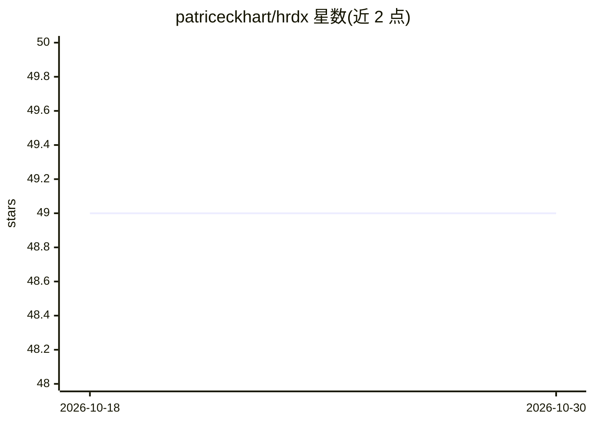

# patriceckhart/hrdx

⭐ 49 · Go · MIT · 推送 2026-10-24 · [GitHub](https://github.com/patriceckhart/hrdx) · [官网](https://hrdx.dev) · 个人维护

**在单个终端中并行运行多个编码 agent 的轻量终端复用器**

面向 agent 时代的实验性终端复用器：以侧边栏工作区组织多项目，每个工作区分标签页，标签页内是真 PTY 终端窗格，可并排运行 Codex CLI、Claude Code、pi、zot 或普通 shell。侧边栏以状态圈/盲文 spinner 指示各 agent 是否仍在工作；退出重启后会话保持、可重新挂接。支持通过 JSON 文件注册任意自定义 agent CLI、JSON socket API 供外部脚本检查与驱动窗格，以及可配置按键与主题。要求 macOS/Linux/Windows 10 1809+，并需至少一个 agent CLI 在 PATH 上。项目自述为 experimental。

## 筛选速览

| 维度 | 判定 | 备注 |
|---|---|---|
| AI 角色 | `ai-ecosystem` | LLM/agent 周边工具 |
| 许可风险 | `permissive` | MIT |
| 部署形态 | `desktop` | 安装包/桌面程序 |
| 模型依赖 | locked-api |  |
| 硬件要求 | — | 无带数字的原话,不猜 |
| 安装摩擦 | `low` | 无编译、无系统依赖或容器化 |
| 成熟度 | `idea` | |

## 能力要点

- 真 PTY 会话窗格，agent TUI 以独立运行方式工作
- 侧边栏 spinner 与颜色状态指示各 agent 运行/完成状态
- JSON 文件注册任意自定义 agent harness（含忙检测）
- JSON socket API 供脚本/编辑器检查状态、派生窗格、读取屏幕、订阅事件

## 适用场景

- 同时开多个项目，让多个编码 agent 并行干活并随时切换
- 重启终端后不丢 agent 会话，重新挂接继续
- 用外部脚本通过 socket API 驱动和监控 agent 窗格

## 场景标签

 · 领域:开发工具/终端

## 证据(README 行号)

> L12: hrdx is a experimental, minimal and lightweight terminal multiplexer built for the agent era: your projects as work
> L32: macOS, Linux, or Windows (10 1809+ / 11, via ConPTY), plus at least one agent CLI on your PATH: `codex`, `claude`, 

## 星数曲线

2026-10-18 49 → 2026-10-30 49（+0）

---
*卡片 v1 · prompt 1.4 · 生成 2026-10-24 · 置信度 high · 依据 README sha `2b3358912ce6` · [字段定义](../../DATASET.md)*
