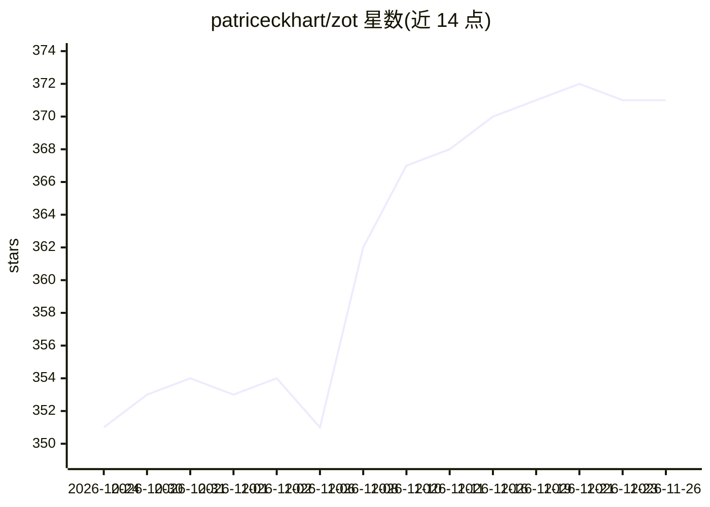

# patriceckhart/zot

⭐ 371 · Go · MIT · 推送 2026-11-24 · [GitHub](https://github.com/patriceckhart/zot) · [官网](https://zot.sh) · 个人维护

**Go 编写的轻量编码 agent 命令行框架，单静态二进制**

zot 是一个编码 agent harness，以 Go 编写并编译为单个静态二进制分发。内置读写编辑/bash/glob 等工具，提供 TUI、print、json 三种运行模式；支持 30+ 模型提供方内置接入，凭据通过 /login、环境变量、auth.json 或密码管理器命令获取，OAuth 令牌自动刷新。通过 AGENTS.md 与 SKILL.md 持久化指令，扩展以子进程 + JSON-RPC 方式接入（默认不装）。`zot continuous` 提供崩溃可恢复的持久化运行，后端可选本地 journal/SQLite 或外部 PostgreSQL（实验性）。

## 筛选速览

| 维度 | 判定 | 备注 |
|---|---|---|
| AI 角色 | `ai-ecosystem` | LLM/agent 周边工具 |
| 许可风险 | `permissive` | MIT |
| 部署形态 | `desktop` | 安装包/桌面程序 |
| 模型依赖 | local-ok | 支持本地模型 |
| 硬件要求 | — | 无带数字的原话,不猜 |
| 安装摩擦 | `medium` | 含编译或系统依赖之一 |
| 成熟度 | — | 结构信号不足 |

## 能力要点

- 单静态二进制，支持 Linux/macOS/Windows 的 amd64 与 arm64 预编译包
- 内置 30+ 模型提供方接入（含 Ollama 本地模型与 AWS Bedrock）
- 持久化、崩溃可恢复的 continuous 运行，审批与预算状态可保留
- 扩展以任意语言经子进程 + JSON-RPC 接入

## 适用场景

- 在终端里用多种模型提供方运行编码 agent
- 通过 Telegram bot 远程与编码 agent 交互
- 需要崩溃恢复的长时间 agent 任务运行

## 场景标签

`Agent 框架` `编码 Agent` · 领域:Agent 开发

## 证据(README 行号)

> L13: Yet another coding agent harness, lightweight and written (vibe-slopped) in go.
> L16: - built-in providers for Anthropic, OpenAI/Codex/Responses, Kimi, DeepSeek, Google Gemini/Vertex, GitHub Copilot, B
> L18: - three run modes (interactive tui, print, json).

## 星数曲线

2026-10-24 351 → 2026-11-26 371（+20）

---
*卡片 v1 · prompt 1.4 · 生成 2026-11-26 · 置信度 high · 依据 README sha `045d1ec9877c` · [字段定义](../../DATASET.md)*
