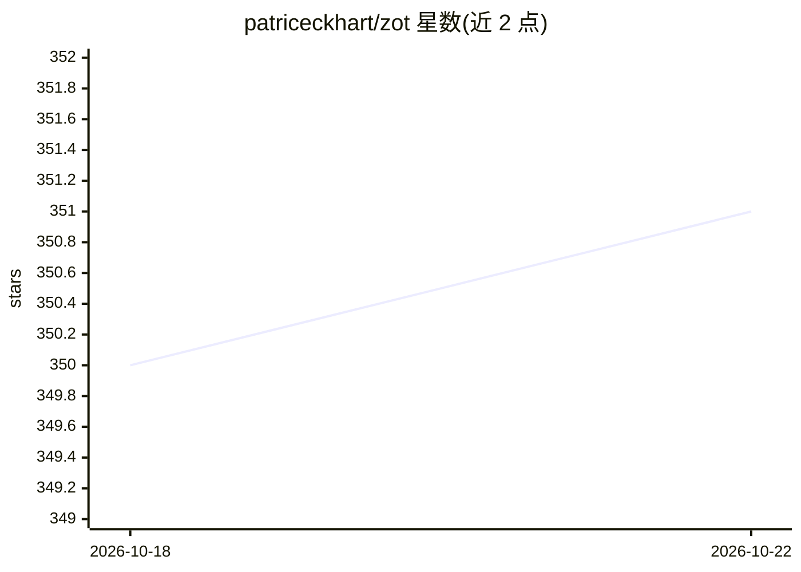

# patriceckhart/zot

⭐ 351 · Go · MIT · 推送 2026-10-21 · [GitHub](https://github.com/patriceckhart/zot) · [官网](https://zot.sh) · 个人维护

**Go 编写的轻量编码代理客户端，一个静态二进制接 30+ 模型**

用 Go 编写的终端编码代理工具：单一静态二进制，内置 30+ 供应商接入（Anthropic、OpenAI、Ollama 本地模型等），提供 read/write/edit/bash/glob 工具与三种运行模式（交互式 TUI、print、json），内置 Telegram 机器人，支持任意语言子进程扩展。认证支持 API key 或复用订阅 OAuth（含 token 自动刷新）；通过 zot continuous 提供可崩溃恢复的持久运行（本地 journal/SQLite 或 PostgreSQL），该特性标注为实验性。

## 筛选速览

| 维度 | 判定 | 备注 |
|---|---|---|
| AI 角色 | `ai-ecosystem` | LLM/agent 周边工具 |
| 许可风险 | `permissive` | MIT |
| 部署形态 | `desktop` | 安装包/桌面程序 |
| 模型依赖 | local-ok | 支持本地模型 |
| 硬件要求 | — | 无带数字的原话,不猜 |
| 安装摩擦 | `medium` | 含编译或系统依赖之一 |
| 成熟度 | — | 结构信号不足 |

## 能力要点

- 单一静态二进制，内置 30+ 供应商（含 Ollama 本地模型）
- 三种运行模式：交互式 TUI、print、json
- durable 可崩溃恢复运行（journal/SQLite/PostgreSQL 后端，实验性）
- AGENTS.md 持久指令、SKILL.md 技能、.zot 便携代理文件

## 适用场景

- 在终端里让 AI 代理读写代码、执行命令完成编码任务
- 通过订阅账号（Claude Pro、ChatGPT Plus 等）或 API key 使用多种模型
- 通过 Telegram 机器人远程驱动编码代理
- 让长时间运行的任务崩溃后可恢复、不重复执行

## 场景标签

 · 领域:开发者工具/编码代理

## 证据(README 行号)

> L13: Yet another coding agent harness, lightweight and written (vibe-slopped) in go.
> L16: - built-in providers for Anthropic, OpenAI/Codex/Responses, Kimi, DeepSeek, Google Gemini/Vertex, GitHub Copilot, B

## 星数曲线

2026-10-18 350 → 2026-10-22 351（+1）

---
*卡片 v1 · prompt 1.4 · 生成 2026-10-21 · 置信度 high · 依据 README sha `7485d18bbe55` · [字段定义](../../DATASET.md)*
