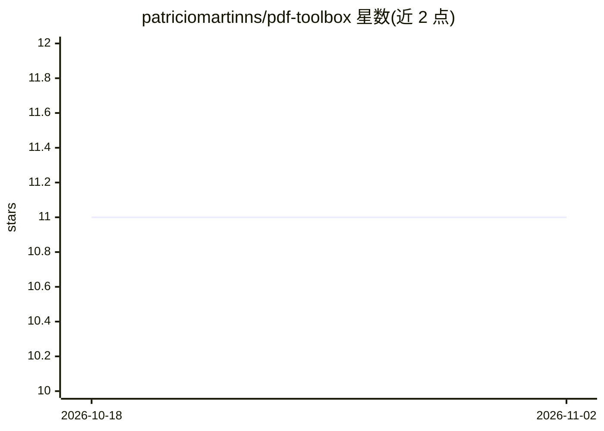

# patriciomartinns/pdf-toolbox

⭐ 11 · Python · MIT · 推送 2025-11-27 · [GitHub](https://github.com/patriciomartinns/pdf-toolbox) · 个人维护

**将本地 PDF 通过 MCP 服务器或 CLI 暴露给 AI agent，含语义检索**

Python 工具：以 FastMCP/STDIO 服务器形式向 Cursor、VS Code、Claude 等 MCP 客户端暴露本地 PDF，或作为独立 pdf-reader CLI 使用。提供有序文本提取（页窗口控制）、基于缓存嵌入的语义相似度搜索（SentenceTransformers，首次运行需下载模型）、确定性分块用于 RAG 流程，以及运行时调整分块参数的配置工具。带沙箱化基础路径、严格 .pdf 校验与缓存机制，输出 JSON 便于管道拼接。通过 uvx/git 安装。

## 筛选速览

| 维度 | 判定 | 备注 |
|---|---|---|
| AI 角色 | `ai-ecosystem` | LLM/agent 周边工具 |
| 许可风险 | `permissive` | MIT |
| 部署形态 | `None` |  |
| 模型依赖 | — | README 未给出锁定关系 |
| 硬件要求 | — | 无带数字的原话,不猜 |
| 安装摩擦 | `low` | 无编译、无系统依赖或容器化 |
| 成熟度 | — | 结构信号不足 |

## 能力要点

- read_pdf 有序文本提取与页窗口控制
- search_pdf 基于缓存嵌入的语义相似度搜索（可调 top_k/阈值/分块参数）
- describe_pdf_sections 输出确定性分块或结构化表格（bbox/headers/cells）
- 沙箱化基础路径与严格 .pdf 校验

## 适用场景

- 给 Cursor/Claude 等 MCP 客户端接入本地 PDF 文档
- 在 RAG 流程前对 PDF 做确定性分块
- 在命令行对 PDF 做语义搜索并输出 JSON

## 场景标签

`RAG` `语义搜索` `文档解析` · 领域:知识与检索

## 证据(README 行号)

> L7: Expose local PDFs to MCP-compatible agents or run the standalone `pdf-reader` CLI with deterministic chunking, seman
> L11: - FastMCP/STDIO server ready for Cursor, VS Code, Claude, and other MCP clients.

## 星数曲线

2026-10-18 11 → 2026-11-02 11（+0）

---
*卡片 v1 · prompt 1.4 · 生成 2026-11-01 · 置信度 high · 依据 README sha `80b194936c52` · [字段定义](../../DATASET.md)*
