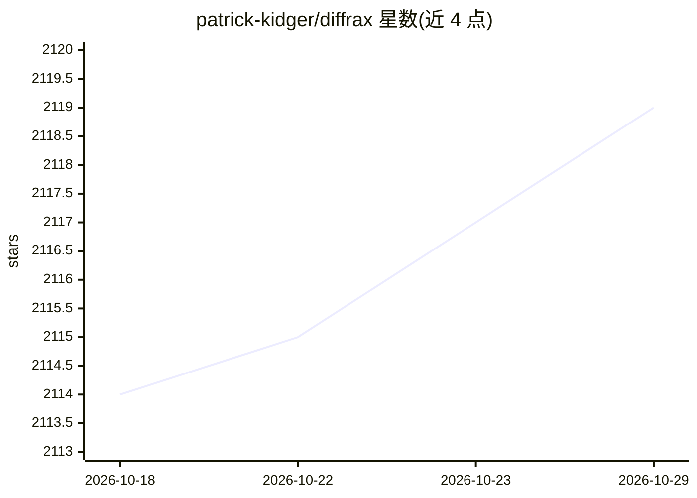

# patrick-kidger/diffrax

⭐ 2,119 · Python · Apache-2.0 · 推送 2026-09-06 · [GitHub](https://github.com/patrick-kidger/diffrax) · 个人维护

**JAX 上的可微分数值微分方程求解器库**

基于 JAX 的数值微分方程求解库，支持 ODE/SDE/CDE 求解，内置 Tsit5、Dopri8、辛几何、隐式等多种求解器，统一处理各类方程。所有组件支持 vmap，状态可用 PyTree，支持稠密解、多种反向传播伴随方法及神经微分方程。面向使用 JAX 的科研与深度学习开发者，通过 pip 安装，需 Python 3.10+。

## 筛选速览

| 维度 | 判定 | 备注 |
|---|---|---|
| AI 角色 | `ai-ecosystem` | LLM/agent 周边工具 |
| 许可风险 | `permissive` | Apache-2.0 |
| 部署形态 | `library` | 以包/库形式分发 |
| 模型依赖 | — | README 未给出锁定关系 |
| 硬件要求 | — | 无带数字的原话,不猜 |
| 安装摩擦 | `low` | 无编译、无系统依赖或容器化 |
| 成熟度 | — | 结构信号不足 |

## 能力要点

- ODE/SDE/CDE 统一求解框架
- 多种求解器（Tsit5、Dopri8、辛几何、隐式）
- vmappable 一切组件，状态支持 PyTree
- 支持神经微分方程与多种伴随反传方法

## 适用场景

- 科研中求解可微分的常微分/随机微分方程
- 构建与训练神经微分方程模型
- 在 JAX 生态中做动力系统的 GPU 加速模拟

## 场景标签

 · 领域:科学计算/机器学习

## 证据(README 行号)

> L2:  Numerical differential equation solvers in JAX. Autodifferentiable and GPU-capable.
> L4: Diffrax is a JAX-based library providing numerical differential equation solvers.

## 星数曲线

2026-10-18 2,114 → 2026-10-29 2,119（+5）

---
*卡片 v1 · prompt 1.4 · 生成 2026-10-21 · 置信度 high · 依据 README sha `f4c5f8df55dd` · [字段定义](../../DATASET.md)*
