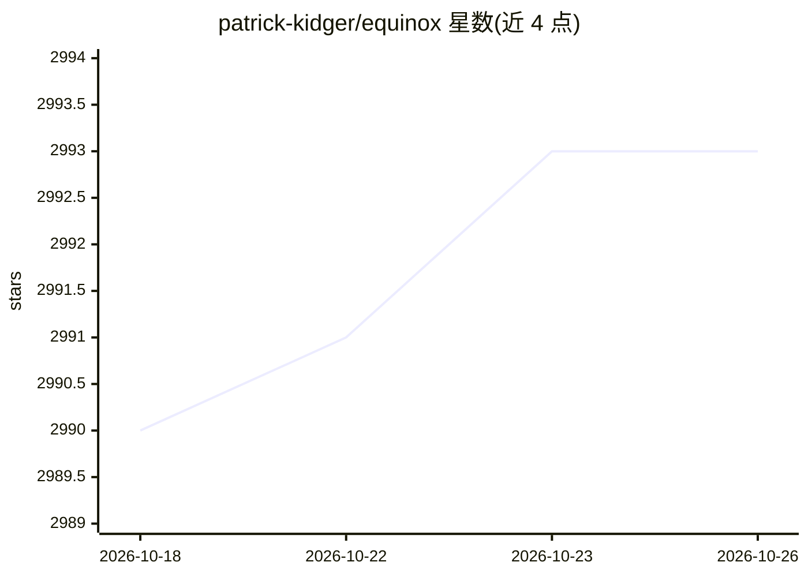

# patrick-kidger/equinox

⭐ 2,993 · Python · Apache-2.0 · 推送 2026-09-06 · [GitHub](https://github.com/patrick-kidger/equinox) · 个人维护

**JAX 神经网络与科学计算库：PyTree 式模型定义**

基于 JAX 的神经网络与科学计算库：以 PyTorch 风格语法定义模型，模型即 PyTree，可直接穿过 JIT/grad 等变换边界；提供过滤式 API 变换、PyTree 操作例程与运行时错误等特性。定位为 JAX 核心的补充而非框架，所写代码与 JAX 生态其他组件兼容。面向使用 JAX 的深度学习与科学计算开发者，需 Python 3.10+，pip 安装，另有 conda-forge 社区构建版本。

## 筛选速览

| 维度 | 判定 | 备注 |
|---|---|---|
| AI 角色 | `ai-ecosystem` | LLM/agent 周边工具 |
| 许可风险 | `permissive` | Apache-2.0 |
| 部署形态 | `library` | 以包/库形式分发 |
| 模型依赖 | — | README 未给出锁定关系 |
| 硬件要求 | — | 无带数字的原话,不猜 |
| 安装摩擦 | `low` | 无编译、无系统依赖或容器化 |
| 成熟度 | — | 结构信号不足 |

## 能力要点

- PyTorch 风格语法定义模型，模型即 PyTree
- filtered transformations 与 PyTree 操作例程
- 非框架定位：与 JAX 生态任意组件兼容
- 提供 jit/grad 下的示例与 arXiv 论文引用

## 适用场景

- 在 JAX 中以熟悉语法定义神经网络模型
- 需要模型可平滑通过 JIT/grad 变换边界的场景
- JAX 科学计算项目中组织 PyTree 结构与变换

## 场景标签

`模型训练` · 领域:训练与推理

## 证据(README 行号)

> L3: Equinox is your one-stop JAX library, for everything you need that isn't already in core JAX:
> L10: and best of all, Equinox isn't a framework: everything you write in Equinox is compatible with anything else in JAX
> L32: Models are defined using PyTorch-like syntax:

## 星数曲线

2026-10-18 2,990 → 2026-10-26 2,993（+3）

---
*卡片 v1 · prompt 1.4 · 生成 2026-10-20 · 置信度 high · 依据 README sha `6135af9d3858` · [字段定义](../../DATASET.md)*
