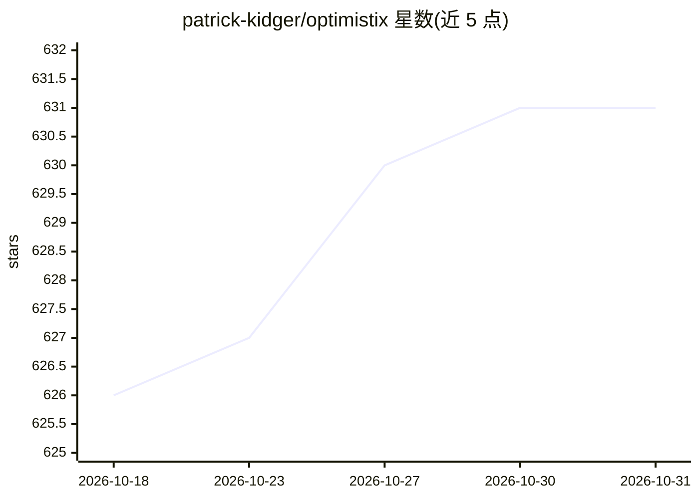

# patrick-kidger/optimistix

⭐ 631 · Python · Apache-2.0 · 推送 2026-08-11 · [GitHub](https://github.com/patrick-kidger/optimistix) · 个人维护

**面向 JAX 的非线性优化库：求根/最小化/不动点/最小二乘**

基于 JAX 与 Equinox 的非线性求解器库，提供求根、最小化、不动点与最小二乘四类问题的求解器。求解器模块化且可互操作，例如将求根问题自动转换为最小二乘问题再用最小化算法求解，或组合 BFGS 二次型、dogleg 下降路径与信赖域更新；状态以 PyTree 表示，可与 Optax 协同使用。需 Python 3.11+，通过 pip 安装。适用于在 JAX 生态中做科学计算与神经网络相关优化的开发者和科研用户。

## 筛选速览

| 维度 | 判定 | 备注 |
|---|---|---|
| AI 角色 | `ai-ecosystem` | LLM/agent 周边工具 |
| 许可风险 | `permissive` | Apache-2.0 |
| 部署形态 | `library` | 以包/库形式分发 |
| 模型依赖 | — | README 未给出锁定关系 |
| 硬件要求 | — | 无带数字的原话,不猜 |
| 安装摩擦 | `low` | 无编译、无系统依赖或容器化 |
| 成熟度 | — | 结构信号不足 |

## 能力要点

- 求根、最小化、不动点、最小二乘四类非线性求解器
- 求解器可互操作：问题可自动转换类型后求解
- 模块化组合：BFGS + dogleg + 信赖域等可搭配
- 继承 JAX 能力：autodiff、自动并行、GPU/TPU 支持

## 适用场景

- 在 JAX 中求解非线性方程组或最小二乘问题
- 为神经网络或科学计算任务组合定制优化器
- 需要可微分、可 GPU/TPU 加速的优化流程

## 场景标签

 · 领域:科学计算/数值优化

## 证据(README 行号)

> L3: Optimistix is a JAX library for nonlinear solvers: root finding, minimisation, fixed points, and least squares.
> L12: - all the benefits of working with JAX: autodiff, autoparallelism, GPU/TPU support etc.

## 星数曲线

2026-10-18 626 → 2026-10-31 631（+5）

---
*卡片 v1 · prompt 1.4 · 生成 2026-10-21 · 置信度 high · 依据 README sha `4d693472588f` · [字段定义](../../DATASET.md)*
