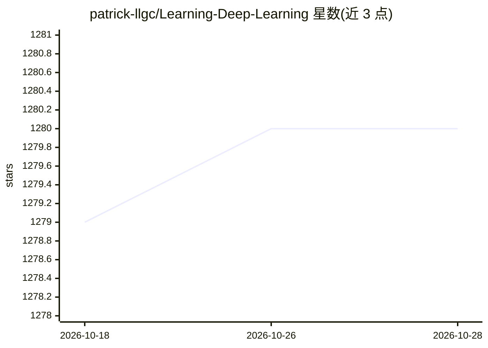

# patrick-llgc/Learning-Deep-Learning

⭐ 1,280 · Jupyter Notebook · 推送 2026-06-04 · [GitHub](https://github.com/patrick-llgc/Learning-Deep-Learning) · 个人维护 · 中文 README

**个人深度学习与自动驾驶论文阅读笔记库**

作者 Patrick Langechuan Liu（Nvidia AI Director）维护的论文阅读笔记仓库，覆盖深度学习与机器学习，重点为自动驾驶感知（BEV、可行驶空间、单目 3D 检测）、扩散与流生成模型、VLA 机器人及世界模型等主题。条目按月份与主题组织，含笔记链接、作者/机构标注与主题综述类博客文章清单，另收录 AI 播客访谈笔记。以 GitHub Pages 生成极简网页呈现，无代码或安装产物。

## 筛选速览

| 维度 | 判定 | 备注 |
|---|---|---|
| AI 角色 | `ai-knowledge` | 知识聚合/清单类 |
| 许可风险 | `none` | — |
| 部署形态 | `None` |  |
| 模型依赖 | — | README 未给出锁定关系 |
| 硬件要求 | — | 无带数字的原话,不猜 |
| 安装摩擦 | `low` | 无编译、无系统依赖或容器化 |
| 成熟度 | — | 结构信号不足 |

## 能力要点

- 按月与按主题组织的论文笔记，含外部笔记链接
- 覆盖自动驾驶感知、扩散/流模型、VLA 与世界模型等方向
- 含综述类博客文章列表与 AI 播客访谈笔记

## 适用场景

- 查找自动驾驶与深度学习领域的入门论文清单
- 按主题定位特定方向（如 BEV 感知、扩散模型）的论文与笔记
- 跟踪 VLA、世界模型等近期方向的论文动态

## 场景标签

`科研工具` `精选清单` · 领域:学习与行业

## 证据(README 行号)

> L1: # Paper notes
> L2: This repository contains my paper reading notes on deep learning and machine learning. It is inspired by Denny Britz

## 星数曲线

2026-10-18 1,279 → 2026-10-28 1,280（+1）

---
*卡片 v1 · prompt 1.4 · 生成 2026-10-21 · 置信度 high · 依据 README sha `f3937d97fd52` · [字段定义](../../DATASET.md)*
