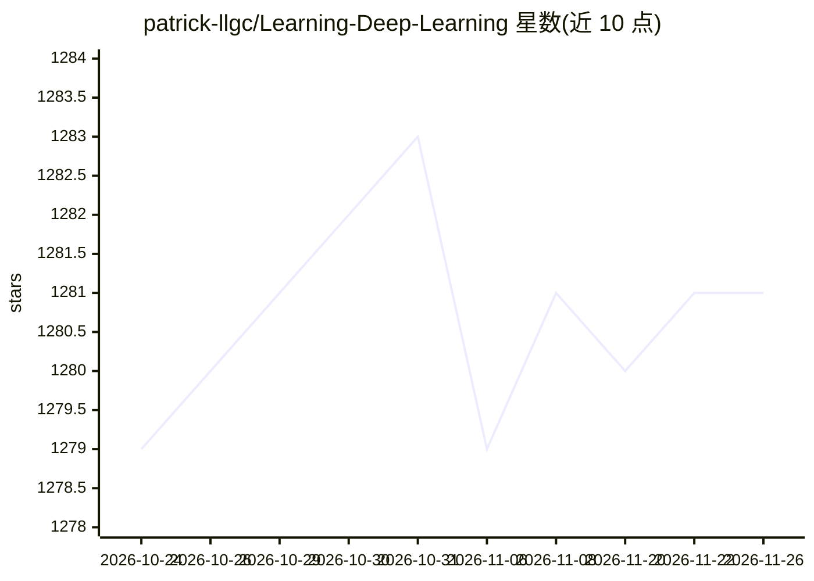

# patrick-llgc/Learning-Deep-Learning

⭐ 1,281 · Jupyter Notebook · 推送 2026-10-27 · [GitHub](https://github.com/patrick-llgc/Learning-Deep-Learning) · 个人维护 · 中文 README

**深度学习与自动驾驶方向的论文阅读笔记清单**

作者 Patrick Liu（Nvidia AI 总监）整理的深度学习与机器学习论文阅读笔记仓库，按月份和主题组织，覆盖扩散语言模型、VLA、自动驾驶端到端、世界模型、BEV 感知等方向，部分条目附笔记链接与作者/机构标注；另含博主评文章节、AI 播客笔记与按主题的速记。内容以论文列表和阅读笔记为主，不含代码或安装说明。

## 筛选速览

| 维度 | 判定 | 备注 |
|---|---|---|
| AI 角色 | `ai-knowledge` | 知识聚合/清单类 |
| 许可风险 | `none` | — |
| 部署形态 | `None` |  |
| 模型依赖 | — | README 未给出锁定关系 |
| 硬件要求 | — | 无带数字的原话,不猜 |
| 安装摩擦 | `low` | 无编译、无系统依赖或容器化 |
| 成熟度 | — | 结构信号不足 |

## 能力要点

- 按月份归档的论文笔记，覆盖 LLM、VLA、自动驾驶、扩散模型等主题
- 按主题组织的博客评文章节（BEV 感知、3D 检测、SLAM 等约 20 篇）
- 附 AI 播客访谈笔记与硬件/注意力掩码等速记小节

## 适用场景

- 入门计算机视觉深度学习时按清单选读论文
- 跟踪自动驾驶端到端与 VLA 方向的最新论文
- 查找扩散语言模型相关论文的阅读笔记

## 场景标签

`精选清单` · 领域:学习与行业

## 证据(README 行号)

> L1: # Paper notes
> L2: This repository contains my paper reading notes on deep learning and machine learning. It is inspired by Denny Britz
> L48: ## 2026-10 (0)

## 星数曲线

2026-10-24 1,279 → 2026-11-26 1,281（+2）

---
*卡片 v1 · prompt 1.4 · 生成 2026-11-23 · 置信度 high · 依据 README sha `34c673c41d7a` · [字段定义](../../DATASET.md)*
