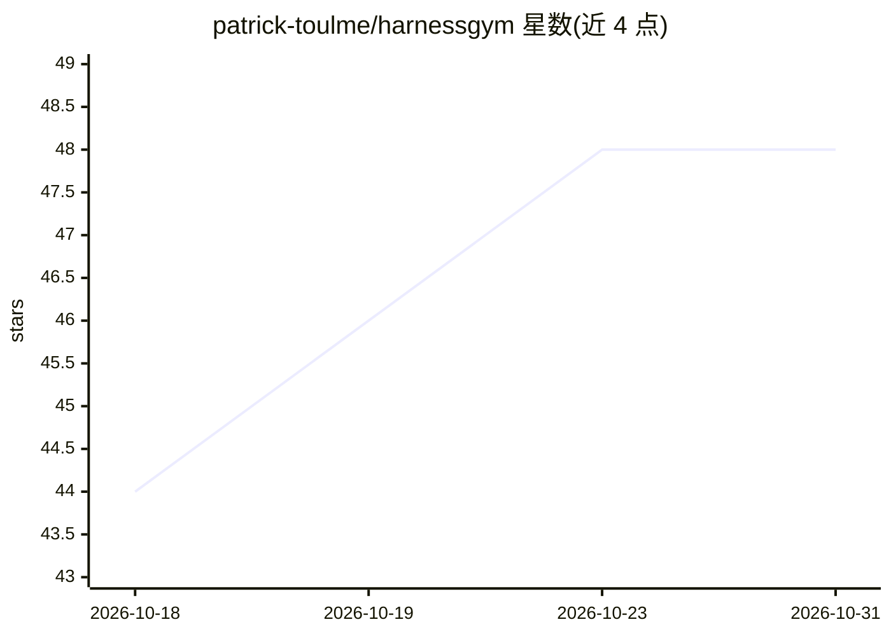

# patrick-toulme/harnessgym

⭐ 48 · Python · Apache-2.0 · 推送 2026-07-02 · [GitHub](https://github.com/patrick-toulme/harnessgym) · [官网](https://harnessgym.com) · 个人维护

**迭代改进编码 agent 工具链的开源框架**

面向评估 agent 工作流的开发者的迭代式 harness 改进框架：在硬任务上运行编码 agent，在同一会话内反思缺失的可复用工具（skill、MCP server、verifier 等），构建单个产物到 .harnessgym/，在干净回放工作区中资格验证（失败可修复或隔离），下一迭代以全新会话携带累积注册表继续。支持 Codex 与 Claude Code 作为 runner，并提供确定性离线 fake runner。核心包无第三方运行时依赖，以 pip 包与 CLI 形式提供；自称 alpha 软件。

## 筛选速览

| 维度 | 判定 | 备注 |
|---|---|---|
| AI 角色 | `ai-ecosystem` | LLM/agent 周边工具 |
| 许可风险 | `permissive` | Apache-2.0 |
| 部署形态 | `library` | 以包/库形式分发 |
| 模型依赖 | — | README 未给出锁定关系 |
| 硬件要求 | — | 无带数字的原话,不猜 |
| 安装摩擦 | `low` | 无编译、无系统依赖或容器化 |
| 成熟度 | `idea` | |

## 能力要点

- 迭代循环：运行任务→反思缺失工具→构建→资格验证→全新会话重放
- 生成的 MCP 工具经自测与隔离机制（quarantine）验证后才进入下一迭代
- compare 命令做带/不带 harness 产物的 A/B 回放对比并记录 MCP 调用遥测
- 支持 Codex、Claude Code 与离线确定性 fake runner 三种后端

## 适用场景

- 让编码 agent 在硬任务上逐步积累可复用的 MCP 工具与技能
- A/B 对比验证 harness 产物是否真正提升任务表现
- 离线 smoke 测试与演示 agent 工作流

## 场景标签

`Agent 框架` `模型评测` · 领域:Agent 开发

## 证据(README 行号)

> L8: HarnessGym is an open-source framework for iterative agent harness improvement. It runs a coding agent on a hard tas
> L10: The package is alpha software for developers evaluating agent workflows. The core package has no third-party runtim

## 星数曲线

2026-10-18 44 → 2026-10-31 48（+4）

---
*卡片 v1 · prompt 1.4 · 生成 2026-10-25 · 置信度 high · 依据 README sha `6ea09217667b` · [字段定义](../../DATASET.md)*
