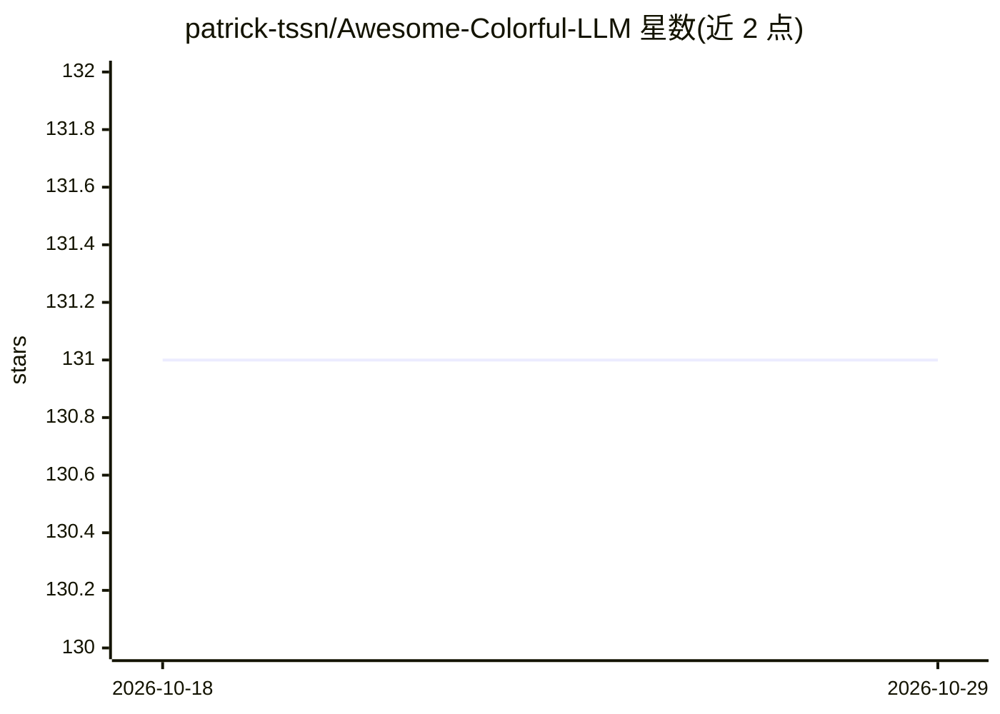

# patrick-tssn/Awesome-Colorful-LLM

⭐ 131 · MIT · 推送 2026-05-07 · [GitHub](https://github.com/patrick-tssn/Awesome-Colorful-LLM) · 个人维护

**多模态 LLM 研究策展清单：覆盖视觉/音频/Agent/机器人等领域**

一个 awesome 类多模态研究资源聚合清单，按 Vision（图像/视频/3D/文档/视觉编码器）、Audio、Agent、Robotics 等领域组织，条目聚焦大语言模型驱动的研究进展，收录相关工作、阅读列表、数据集与基准、开源项目，并汇集大量相关子领域策展仓库与 CVPR 教程链接。条目附 GitHub 动态提交徽章以显示更新状态。面向需要检索多模态 LLM 相关文献与资源的研究者与开发者，仓库本身不提供可运行的代码或安装方式。

## 筛选速览

| 维度 | 判定 | 备注 |
|---|---|---|
| AI 角色 | `ai-knowledge` | 知识聚合/清单类 |
| 许可风险 | `permissive` | MIT |
| 部署形态 | `None` |  |
| 模型依赖 | — | README 未给出锁定关系 |
| 硬件要求 | — | 无带数字的原话,不猜 |
| 安装摩擦 | `low` | 无编译、无系统依赖或容器化 |
| 成熟度 | — | 结构信号不足 |

## 能力要点

- 按 Vision/Audio/Agent/Robotics 等领域分类组织多模态 LLM 研究
- 每个领域细分阅读列表、数据集与基准、项目与应用
- 汇集数十个相关子领域策展仓库并附动态更新徽章
- 收录 CVPR 2020-2024 视觉基础模型教程列表

## 适用场景

- 查找图像/视频/3D/音频等多模态 LLM 论文与数据集
- 追踪 LLM 驱动的 Agent 与机器人研究进展
- 发现各子领域的其他策展清单作为延伸入口

## 场景标签

`精选清单` · 领域:学习与行业

## 证据(README 行号)

> L7: Welcome to our meticulously assembled anthology of vibrant multimodal research, encompassing an array of domains inc
> L17: Collection of works about Image + LLMs, Diffusion, see Image for details

## 星数曲线

2026-10-18 131 → 2026-10-29 131（+0）

---
*卡片 v1 · prompt 1.4 · 生成 2026-10-23 · 置信度 high · 依据 README sha `7d4b0b352400` · [字段定义](../../DATASET.md)*
