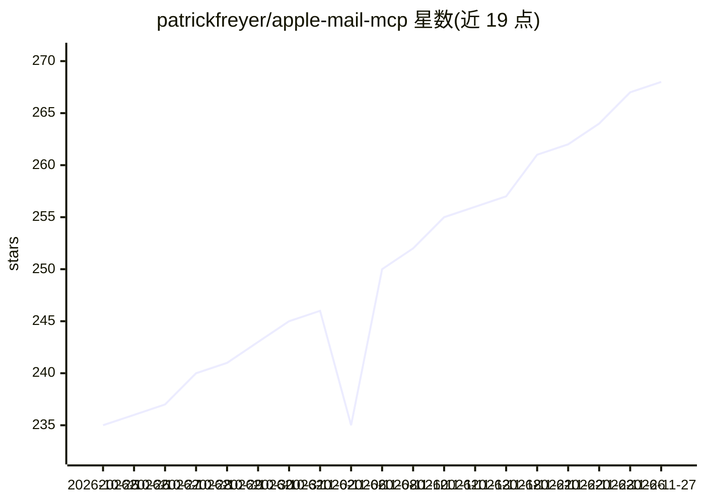

# patrickfreyer/apple-mail-mcp

⭐ 268 · Python · MIT · 推送 2026-11-25 · [GitHub](https://github.com/patrickfreyer/apple-mail-mcp) · 个人维护

**让 AI 助手通过 MCP 读写与管理 Apple Mail 的 macOS 服务器**

基于 fastmcp 的 MCP 服务器，将 Apple Mail 接入 Claude Code、Codex、Cursor 等 MCP 兼容客户端，提供 28 个工具：读取/搜索邮件、文件夹组织、撰写与回复、附件管理、未回复/待回复识别、统计与导出。通过 AppleScript/Automation 权限驱动 Mail.app，要求 macOS。带安全设计：只读模式、批量操作上限、针对 prompt injection 的文件写入/附件路径拒绝清单与可选目录白名单。另含邮件管理技能（Email Management Expert）与 Claude 插件分发方式。

## 筛选速览

| 维度 | 判定 | 备注 |
|---|---|---|
| AI 角色 | `ai-ecosystem` | LLM/agent 周边工具 |
| 许可风险 | `permissive` | MIT |
| 部署形态 | `library` | 以包/库形式分发 |
| 模型依赖 | locked-api |  |
| 硬件要求 | — | 无带数字的原话,不猜 |
| 安装摩擦 | `low` | 无编译、无系统依赖或容器化 |
| 成熟度 | — | 结构信号不足 |

## 能力要点

- 28 个 MCP 工具覆盖读取、搜索、组织、撰写、附件、统计与导出
- 只读模式与批量操作默认上限（移动 1 封/删除 5 封等）
- 针对邮件提示注入的写入路径拒绝清单与可选目录限制
- 随附 Claude Code 邮件管理技能（Inbox Zero/每日分拣工作流）

## 适用场景

- 用自然语言让 AI 助手整理收件箱、归档邮件
- 让助手按主题搜索并代拟回复或草稿
- 统计近 30 天邮件量与高频发件人
- 导出邮件/邮箱为 TXT 或 HTML 备份

## 场景标签

`AI 助手` · 领域:对话与助手

## 证据(README 行号)

> L13: **Prerequisites:** macOS with Apple Mail configured, Python 3.10+, and uv (the plugin and uvx installs launch the s
> L101: ## Tools (28)
> L254: - Claude Desktop or any MCP-compatible client

## 星数曲线

2026-10-25 235 → 2026-11-27 268（+33）

---
*卡片 v1 · prompt 1.4 · 生成 2026-11-26 · 置信度 mid · 依据 README sha `f44908675e0b` · [字段定义](../../DATASET.md)*
