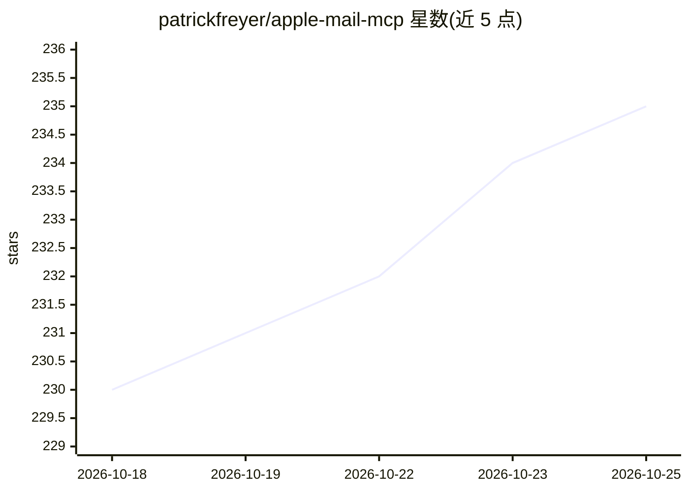

# patrickfreyer/apple-mail-mcp

⭐ 236 · Python · MIT · 推送 2026-10-21 · [GitHub](https://github.com/patrickfreyer/apple-mail-mcp) · 个人维护

**让 AI 助手通过自然语言操作 Apple Mail 的 MCP 服务器**

面向 macOS 的 MCP 服务器，通过 AppleScript/自动化权限连接本地 Mail.app，向 Claude 等兼容 MCP 的客户端暴露 22 个工具：收件箱概览与统一搜索、邮箱整理（移动/标记/删除，带批量限额与 dry-run）、撰写与回复（纯文本/HTML、草稿管理）、附件保存、Smart Inbox（待回复/需回复分析）与统计分析、导出。提供 `--read-only` 模式禁发邮件，并有针对提示注入攻击的文件写入/附件路径拒绝清单与可选目录白名单。附赠 Claude Code 的邮件管理技能插件。

## 筛选速览

| 维度 | 判定 | 备注 |
|---|---|---|
| AI 角色 | `ai-ecosystem` | LLM/agent 周边工具 |
| 许可风险 | `permissive` | MIT |
| 部署形态 | `library` | 以包/库形式分发 |
| 模型依赖 | — | README 未给出锁定关系 |
| 硬件要求 | — | 无带数字的原话,不猜 |
| 安装摩擦 | `low` | 无编译、无系统依赖或容器化 |
| 成熟度 | — | 结构信号不足 |

## 能力要点

- 22 个邮件工具：搜索、整理、撰写、附件、分析、导出
- --read-only 模式阻止发送邮件
- 针对提示注入的写入/附件路径拒绝清单与目录白名单
- 批量操作默认保守限额（移动 1 封、标记 10 封、删除 5 封）

## 适用场景

- 让 Claude 等客户端直接搜索、整理和回复我的邮件
- 用 AI 做收件箱分诊与统计分析
- 生成富 HTML 邮件草稿并在 Mail 中编辑

## 场景标签

 · 领域:邮件自动化/工具

## 证据(README 行号)

> L17: Two commands — gets you the MCP server, `/email-management` slash command, and the Email Management Expert skill:
> L227: - Claude Desktop or any MCP-compatible client

## 星数曲线

2026-10-18 230 → 2026-10-25 235（+5）

---
*卡片 v1 · prompt 1.4 · 生成 2026-10-22 · 置信度 mid · 依据 README sha `294d07b6d98d` · [字段定义](../../DATASET.md)*
