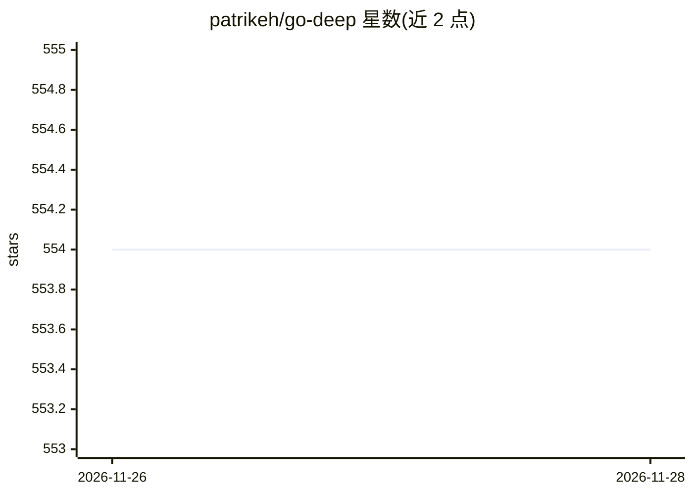

# patrikeh/go-deep

⭐ 554 · Go · MIT · 推送 2026-11-24 · [GitHub](https://github.com/patrikeh/go-deep) · 个人维护

**Go 语言前馈/反向传播神经网络库，用于分类与回归**

以 Go 库形式实现的前馈神经网络与反向传播训练：支持 sigmoid、双曲、ReLU 激活函数，SGD（含 momentum/nesterov）与 Adam 优化器，以及回归、多类、多标签、二分类模式；提供并行批量训练、偏置节点、网络序列化（Marshal/Unmarshal）。README 明确说明仅使用 CPU 计算，不适用于大规模应用。通过 go get 安装，代码示例覆盖训练与预测流程。

## 筛选速览

| 维度 | 判定 | 备注 |
|---|---|---|
| AI 角色 | `ai-native` | 本体是模型或模型工具 |
| 许可风险 | `permissive` | MIT |
| 部署形态 | `None` |  |
| 模型依赖 | — | README 未给出锁定关系 |
| 硬件要求 | — | 无带数字的原话,不猜 |
| 安装摩擦 | `low` | 无编译、无系统依赖或容器化 |
| 成熟度 | — | 结构信号不足 |

## 能力要点

- 支持 sigmoid/hyperbolic/ReLU 激活与 SGD/Adam 优化器
- 支持回归、多类、多标签、二分类四种模式
- 并行批量训练与固定随机种子保证可复现
- 训练后网络可 Marshal 序列化保存与加载

## 适用场景

- 在 Go 项目中训练小型神经网络做分类或回归
- 将训练好的网络序列化后加载用于预测
- 参考 examples/ 中的 wines、mnist 等数据集示例

## 场景标签

`模型训练` · 领域:训练与推理

## 证据(README 行号)

> L7: Feed forward/backpropagation neural network implementation. Currently supports:
> L11: - Classification modes: regression, multi-class, multi-label, binary
> L74: 	prediction, err := n.Predict(e.Input)

## 星数曲线

2026-11-26 554 → 2026-11-28 554（+0）

---
*卡片 v1 · prompt 1.4 · 生成 2026-11-27 · 置信度 high · 依据 README sha `aab1f31f6ac5` · [字段定义](../../DATASET.md)*
