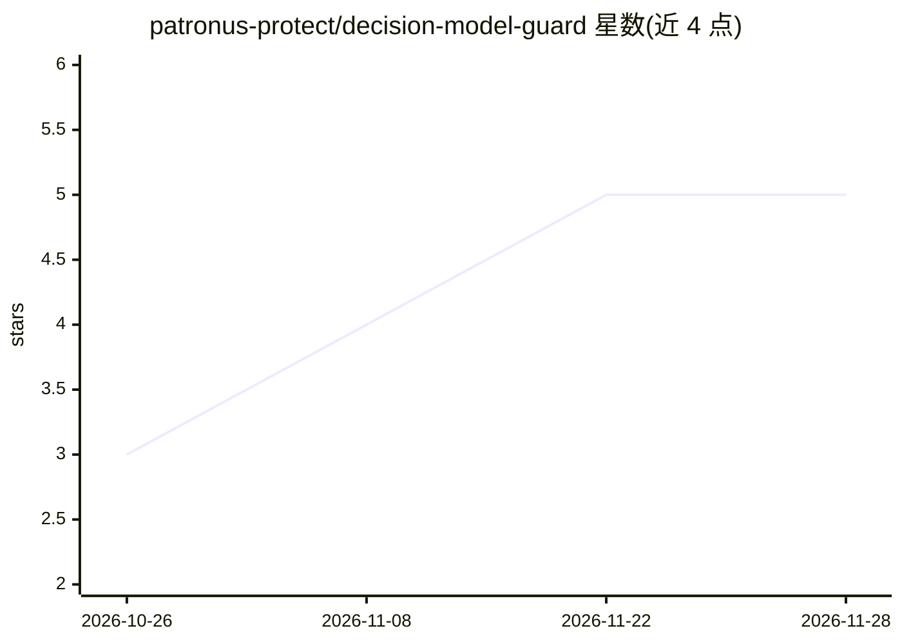

# patronus-protect/decision-model-guard

⭐ 5 · Python · MIT · 推送 2026-11-20 · [GitHub](https://github.com/patronus-protect/decision-model-guard) · [官网](https://patronus.studio) · 组织维护

**给分类器与 LLM 裁判加护栏的库：阻止内容注入扭转判定**

面向决策模型（分类器、Jev 类模型、LLM-as-a-judge）的护栏库：在输入侧扫描不可信文本中的决策声明、提示注入、伪造可信块与隐形字符，围绕模型运行 erase-and-check 转向门，再做覆盖率/不变性/共形弃答检查，并按策略输出 allow/cautious/fallback/escalate/abstain/block 动作与 JSONL 审计日志。提供 CLI、YAML 配置、FastAPI 服务与 `dmguard audit` 健壮性审计（可作 CI 门）。模型权重不被改动，通过 ONNX Runtime 或 PyTorch 或 HTTP/OpenAI 兼容接口接入任意决策模型。

## 筛选速览

| 维度 | 判定 | 备注 |
|---|---|---|
| AI 角色 | `ai-ecosystem` | LLM/agent 周边工具 |
| 许可风险 | `permissive` | MIT |
| 部署形态 | `library` | 以包/库形式分发 |
| 模型依赖 | — | README 未给出锁定关系 |
| 硬件要求 | — | 无带数字的原话,不猜 |
| 安装摩擦 | `low` | 无编译、无系统依赖或容器化 |
| 成熟度 | — | 结构信号不足 |

## 能力要点

- 转向门逐段擦除不可信文本并批量重问，组合答案防止声明扭转决策
- 内容扫描器：声明检测、提示注入（Wolf Defender）、伪造可信块、verdict token、隐形字符
- dmguard audit 十项攻击/压力检查并输出记分卡，可设 --max-attack-success 作 CI 门
- 支持 ONNX Runtime（免 torch）、PyTorch、HTTP 端点与 OpenAI 兼容 LLM 裁判

## 适用场景

- 保护工单路由/退款判定模型不被工单内一句话扭转结论
- 审计自己决策模型在注入攻击下的成功率并接入 CI
- 为提取模型拦截植入的金额/数值
- 对置信度不可靠的判定接入共形弃答策略

## 场景标签

`网络安全` · 领域:学习与行业

## 证据(README 行号)

> L12: **Guardrails for decision models: classifiers, Jev-like models and LLM-as-a-judge.** Decision models read a ticket,
> L58: - **Runs anywhere**: ONNX Runtime without torch (58 MB claim detector, 118 MB Wolf Defender Jev), PyTorch, HTTP end
> L56: - **Robustness audit**: `dmguard audit` attacks your model with ten checks and reports attack success with and with

## 星数曲线

2026-10-26 3 → 2026-11-28 5（+2）

---
*卡片 v1 · prompt 1.4 · 生成 2026-11-21 · 置信度 mid · 依据 README sha `211ac5f992ee` · [字段定义](../../DATASET.md)*
