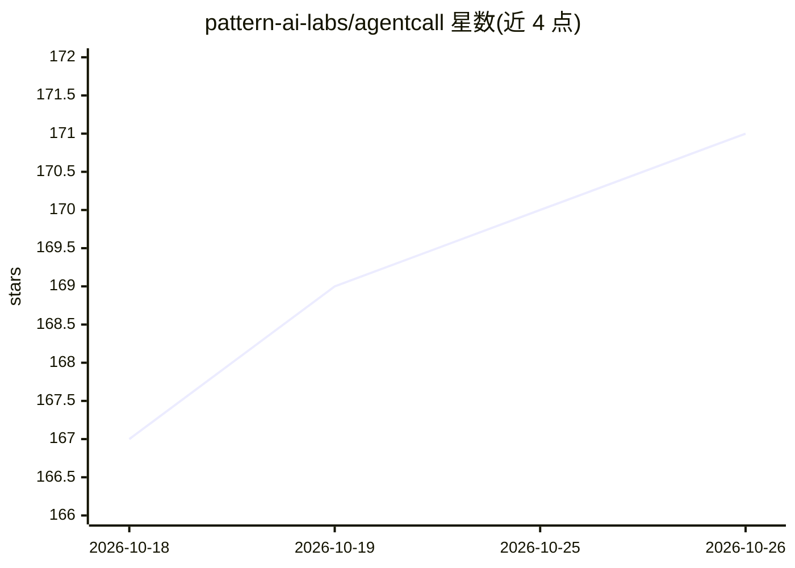

# pattern-ai-labs/agentcall

⭐ 171 · Python · MIT · 推送 2026-10-24 · [GitHub](https://github.com/pattern-ai-labs/agentcall) · [官网](https://agentcall.dev) · 组织维护

**让 AI 编程代理以语音/视频加入线上会议的技能插件**

AgentCall 的 join-meeting 技能：使 Claude Code、Cursor、Codex、Gemini CLI 等 30+ 编程代理以机器人身份加入 Google Meet、Zoom、Teams 会议，具备语音对话（54 种音色、9 种语言）、实时转录、屏幕截图、动态头像、屏幕共享与聊天收发能力，代理在通话中保留完整会话上下文。以技能形式提供，需运行在编程代理之上，依赖 Python 3.10+ 或 Node.js 18+ 及 AgentCall 账号，通过 api.agentcall.dev 的 REST 与 WebSocket 接口工作，基础版含 6 小时会议时长。

## 筛选速览

| 维度 | 判定 | 备注 |
|---|---|---|
| AI 角色 | `ai-ecosystem` | LLM/agent 周边工具 |
| 许可风险 | `permissive` | MIT |
| 部署形态 | `library` | 以包/库形式分发 |
| 模型依赖 | — | README 未给出锁定关系 |
| 硬件要求 | — | 无带数字的原话,不猜 |
| 安装摩擦 | `low` | 无编译、无系统依赖或容器化 |
| 成熟度 | — | 结构信号不足 |

## 能力要点

- 支持 Google Meet、Zoom、Teams，提供语音/头像/屏幕共享三种模式
- 54 种音色、9 种语言的 TTS 与实时转录
- VAD 断句缓冲、打断检测、WebSocket 自动重连与崩溃恢复
- 兼容 30+ 编程代理框架，通过 SKILL.md 标准（子进程 + stdout）接入

## 适用场景

- 让编程代理边开会边继续搜索代码、编辑文件和提交变更
- 把会议作为代理的另一个 I/O 通道做纪要或客服
- 在群组会议中让代理通过语音智能协商发言时机

## 场景标签

`语音 Agent` · 领域:对话与助手

## 证据(README 行号)

> L25: This is a **skill, not a standalone app** — it runs on top of a coding agent. You'll need:
> L131: Works with any agent that can spawn a subprocess and read stdout:

## 星数曲线

2026-10-18 167 → 2026-10-26 171（+4）

---
*卡片 v1 · prompt 1.4 · 生成 2026-10-22 · 置信度 mid · 依据 README sha `bf8cdb445db9` · [字段定义](../../DATASET.md)*
