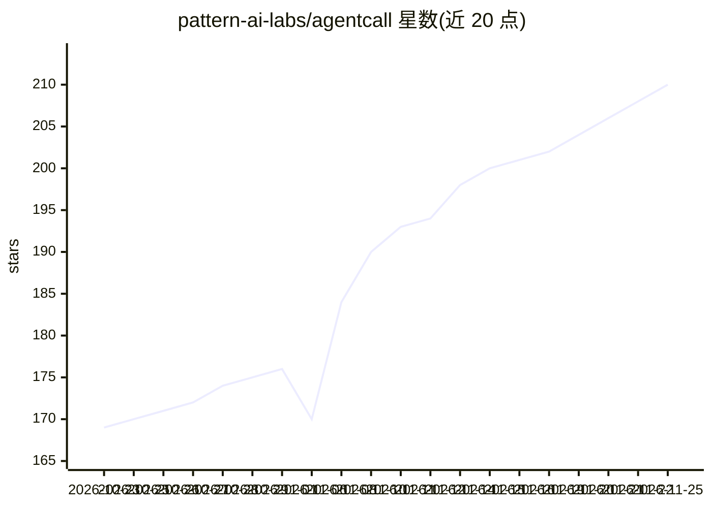

# pattern-ai-labs/agentcall

⭐ 210 · Python · MIT · 推送 2026-11-15 · [GitHub](https://github.com/pattern-ai-labs/agentcall) · [官网](https://agentcall.dev) · 组织维护

**让 AI 编码代理以语音/视频加入 Google Meet/Zoom/Teams 会议的技能**

AgentCall 是一个 Agent Skills 标准格式的技能（非独立应用），运行在 Claude Code、Cursor、Codex 等 30+ 编码代理之上，使代理以机器人身份加入 Google Meet、Zoom（Beta）和 Microsoft Teams 会议：通过 TTS 发言（54 种声音、9 种语言）、接收实时转写、截取共享屏幕、展示动画头像、屏幕共享与收发会议聊天。代理保留完整会话上下文，可在会议中继续搜索代码、编辑文件、执行命令。需 AgentCall 账号与 API key，采用免费基础额度加按分钟计费的定价。

## 筛选速览

| 维度 | 判定 | 备注 |
|---|---|---|
| AI 角色 | `ai-ecosystem` | LLM/agent 周边工具 |
| 许可风险 | `permissive` | MIT |
| 部署形态 | `library` | 以包/库形式分发 |
| 模型依赖 | — | README 未给出锁定关系 |
| 硬件要求 | — | 无带数字的原话,不猜 |
| 安装摩擦 | `low` | 无编译、无系统依赖或容器化 |
| 成熟度 | — | 结构信号不足 |

## 能力要点

- 支持 Google Meet、Zoom（Beta）、Microsoft Teams 三个会议平台
- 三种语音策略：direct（代理直控 TTS）/ collaborative / realtime（自听自答，可向代理请求任务）
- 三种模式：audio、webpage-av（头像）、webpage-av-screenshare（头像+屏幕共享）
- 兼容 Agent Skills 开放标准的 30+ 代理框架，含 VAD 缓冲、插话检测、断线重连与崩溃恢复机制

## 适用场景

- 让编码代理在会议中口头汇报代码改动并现场演示
- 会议记录：代理入会生成实时转写
- 代理在会议中共享仪表盘或幻灯片做演示
- 远程协作时通过会议对话指挥代理执行任务

## 场景标签

`语音 Agent` · 领域:对话与助手

## 证据(README 行号)

> L5: An AgentCall skill that enables AI coding agents (Claude Code, Cursor, Codex, Gemini CLI, OpenClaw, Windsurf, Junie,
> L26: This is a **skill, not a standalone app** — it runs on top of a coding agent. You'll need:
> L26: This is a **skill, not a standalone app** — it runs on top of a coding agent. You'll need:
> L85: Then point your agent at `agentcall/SKILL.md` (the open Agent Skills standard, supported by 30+ frameworks):

## 星数曲线

2026-10-23 169 → 2026-11-25 210（+41）

---
*卡片 v1 · prompt 1.4 · 生成 2026-11-25 · 置信度 mid · 依据 README sha `45e9cfab4e18` · [字段定义](../../DATASET.md)*
