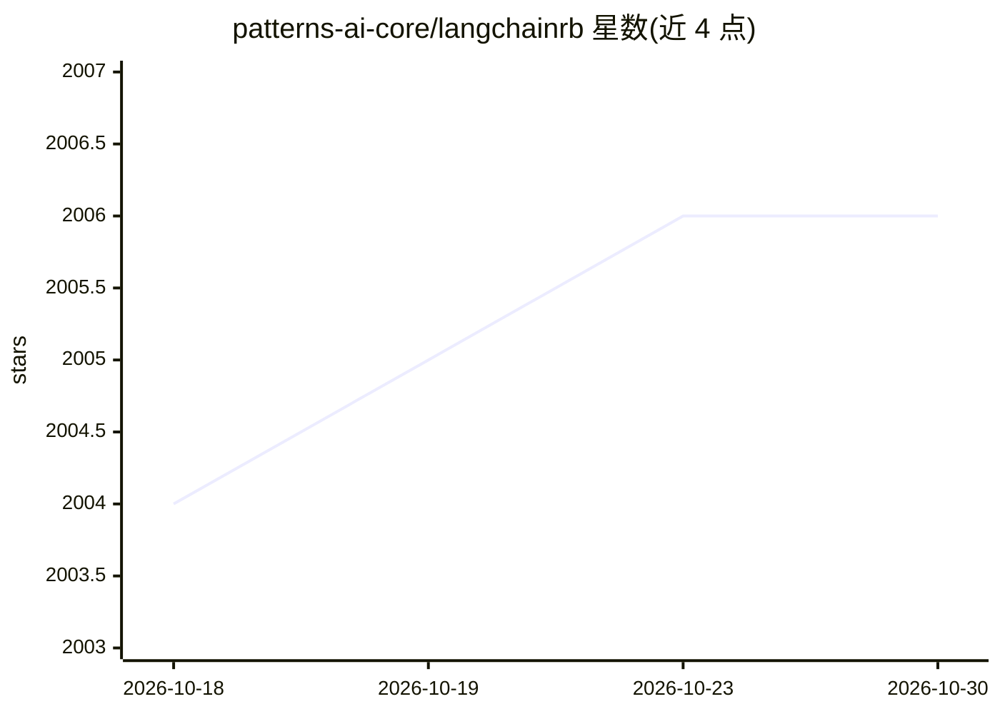

# patterns-ai-core/langchainrb

⭐ 2,006 · Ruby · MIT · 推送 2026-10-21 · [GitHub](https://github.com/patterns-ai-core/langchainrb) · [官网](https://rubydoc.info/gems/langchainrb) · 个人维护

**Ruby 版 LLM 应用构建框架：统一接口接入多家模型与向量库**

面向 Ruby/Rails 开发者的 LLM 应用开发库，提供统一 LLM 接口（embed/complete/chat 及工具调用），支持 Anthropic、AWS Bedrock、Azure OpenAI、Cohere、Ollama、OpenAI 等 11 家提供方，可切换后端而不改业务代码。另含提示模板（PromptTemplate/FewShot、JSON/YAML 加载）、输出解析器（结构化 JSON 解析与自动修复）、以及覆盖 Chroma、Milvus、Pgvector、Qdrant、Weaviate 等 8 种向量库的 RAG 构建接口，支持 PDF/DOCX 等 11 种文件格式解析入库与 HyDE 检索。以 Ruby gem 分发，附加依赖 gem 需自行按需引入；另有 langchainrb_rails gem 提供 Rails 深度集成。

## 筛选速览

| 维度 | 判定 | 备注 |
|---|---|---|
| AI 角色 | `ai-ecosystem` | LLM/agent 周边工具 |
| 许可风险 | `permissive` | MIT |
| 部署形态 | `None` |  |
| 模型依赖 | local-ok | 支持本地模型 |
| 硬件要求 | — | 无带数字的原话,不猜 |
| 安装摩擦 | `low` | 无编译、无系统依赖或容器化 |
| 成熟度 | — | 结构信号不足 |

## 能力要点

- 统一 LLM 接口支持 11 家提供方，可切换后端不改代码
- 向量搜索统一接口覆盖 Chroma/Milvus/Pgvector/Qdrant/Weaviate 等 8 种数据库
- 提示模板与输出解析器（含 OutputFixingParser 自动修复解析失败）
- RAG 数据入库支持 docx/pdf/csv 等 11 种文件格式及 HyDE 检索

## 适用场景

- 在 Ruby/Rails 项目中构建 RAG 问答与向量检索系统
- 通过统一接口在多家 LLM 提供方之间切换
- 搭建带结构化输出解析的聊天助手

## 场景标签

`RAG` `Agent 框架` `提示工程` · 领域:Agent 开发

## 证据(README 行号)

> L41: The `Langchain::LLM` module provides a unified interface for interacting with various Large Language Model (LLM) pr
> L279: Langchain.rb provides a convenient unified interface on top of supported vectorsearch databases that make it easy 

## 星数曲线

2026-10-18 2,004 → 2026-10-30 2,006（+2）

---
*卡片 v1 · prompt 1.4 · 生成 2026-10-21 · 置信度 high · 依据 README sha `6fdb15b872f4` · [字段定义](../../DATASET.md)*
