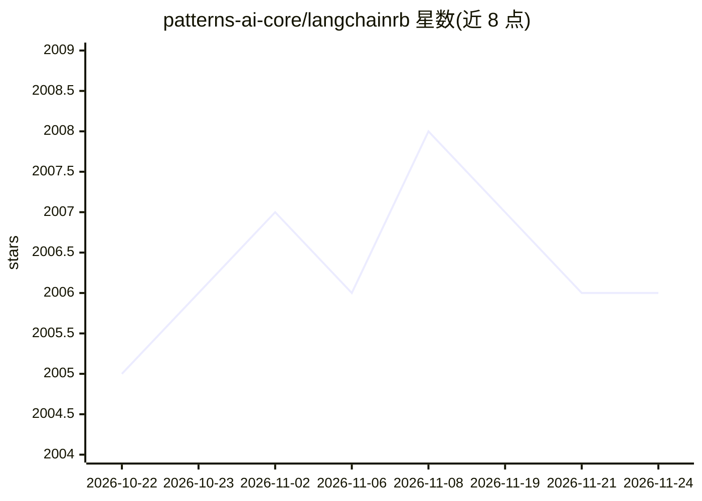

# patterns-ai-core/langchainrb

⭐ 2,006 · Ruby · MIT · 推送 2026-10-21 · [GitHub](https://github.com/patterns-ai-core/langchainrb) · [官网](https://rubydoc.info/gems/langchainrb) · 个人维护

**Ruby 开发者的 LLM 应用构建框架：统一接口接入多家模型**

一个 Ruby gem，为在 Ruby 中构建 LLM 应用提供统一抽象层：Langchain::LLM 模块对多家 LLM 提供商封装一致的 embed/complete/chat 接口，可切换后端而不改应用代码；另含提示词模板（JSON/YAML 加载）、结构化输出解析器与解析失败自动修复、RAG 工作流支持及对 8 种向量数据库的统一客户端接口，支持 PDF/docx/CSV 等 10 种文件格式索引进库。通过 gem 安装，向量化数据库等附加功能需按需引入额外 gem。

## 筛选速览

| 维度 | 判定 | 备注 |
|---|---|---|
| AI 角色 | `ai-ecosystem` | LLM/agent 周边工具 |
| 许可风险 | `permissive` | MIT |
| 部署形态 | `None` |  |
| 模型依赖 | local-ok | 支持本地模型 |
| 硬件要求 | — | 无带数字的原话,不猜 |
| 安装摩擦 | `low` | 无编译、无系统依赖或容器化 |
| 成熟度 | — | 结构信号不足 |

## 能力要点

- 统一接口封装 12 家 LLM 提供商（embed/complete/chat）
- 支持 8 种向量数据库的统一客户端与相似度检索（含 HyDE）
- 提示词模板与结构化输出解析器（含 OutputFixingParser 修复）
- 文件解析器支持 docx/pdf/csv/xlsx 等 10 种格式入库

## 适用场景

- 用 Ruby 构建聊天机器人与助手应用
- 搭建 RAG 问答系统并接入向量数据库
- 在多家 LLM 提供商之间切换而不改业务代码

## 场景标签

`Agent 框架` `RAG` · 领域:Agent 开发

## 证据(README 行号)

> L41: The `Langchain::LLM` module provides a unified interface for interacting with various Large Language Model (LLM) pr
> L279: Langchain.rb provides a convenient unified interface on top of supported vectorsearch databases that make it easy 

## 星数曲线

2026-10-22 2,005 → 2026-11-24 2,006（+1）

---
*卡片 v1 · prompt 1.4 · 生成 2026-11-24 · 置信度 high · 依据 README sha `ec49c6c32ddf` · [字段定义](../../DATASET.md)*
