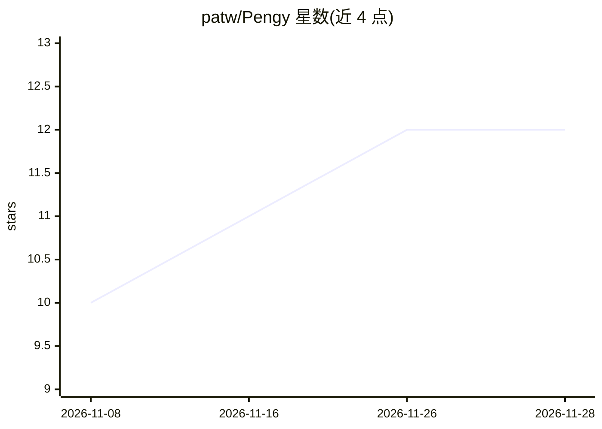

# patw/Pengy

⭐ 12 · Python · MIT · 推送 2026-11-22 · [GitHub](https://github.com/patw/Pengy) · [官网](https://pengy.catbee.ca) · 个人维护

**本地优先的 LLM agent 客户端：桌面/CLI/Web 三界面带 16 个工具**

在本机运行的 LLM agent，默认连接本地 Ollama 的 OpenAI 兼容端口，也可指向 llama.cpp、vLLM、LM Studio 或任意托管 OpenAI 兼容 API。为模型提供 16 个内置工具（读写文件、执行 bash/Python、搜索网页、抓取 URL、目录探索等），支持工具调用确认模式、多轮工具链式调用、标签页聊天、任务模板与可扩展 skills。提供 Qt6 桌面、CLI REPL 和 Web UI 三种界面，共享同一核心与配置；通过 uv 或 pip 安装。

## 筛选速览

| 维度 | 判定 | 备注 |
|---|---|---|
| AI 角色 | `ai-native` | 本体是模型或模型工具 |
| 许可风险 | `permissive` | MIT |
| 部署形态 | `desktop` | 安装包/桌面程序 |
| 模型依赖 | local-ok | 支持本地模型 |
| 硬件要求 | — | 无带数字的原话,不猜 |
| 安装摩擦 | `low` | 无编译、无系统依赖或容器化 |
| 成熟度 | — | 结构信号不足 |

## 能力要点

- 16 个内置工具：文件读写、shell/Python 执行、网页搜索与 URL 抓取
- 三种界面（Qt6 GUI / CLI / Web）共享同一 agent 核心、历史与配置
- 默认本地 Ollama 端点，无需 API key；工具调用提供三种确认模式
- Skills 机制：本地指令文件加可选辅助脚本扩展 agent 能力

## 适用场景

- 在本地用 Ollama 运行带工具调用的 agent 处理文件和代码任务
- 通过单条命令把 agent 接入脚本与自动化流程
- 部署 Web UI 在服务器上从手机远程访问个人 agent
- 用任务模板重复执行视频摘要、发布说明等固定工作流

## 场景标签

`AI 助手` · 领域:对话与助手

## 证据(README 行号)

> L3: **A local-first AI agent with tools.** Desktop GUI, web UI, **and** command-line — all backed by the same agent core
> L11: Pengy is an LLM agent that runs on your own machine. It defaults to a **local server** — Ollama's OpenAI-compatible
> L143: - **16 built-in tools** — Read files and inspect images; write and edit files transactionally; run bash (with sudo

## 星数曲线

2026-11-08 10 → 2026-11-28 12（+2）

---
*卡片 v1 · prompt 1.4 · 生成 2026-11-18 · 置信度 high · 依据 README sha `3a6287f0f61c` · [字段定义](../../DATASET.md)*
