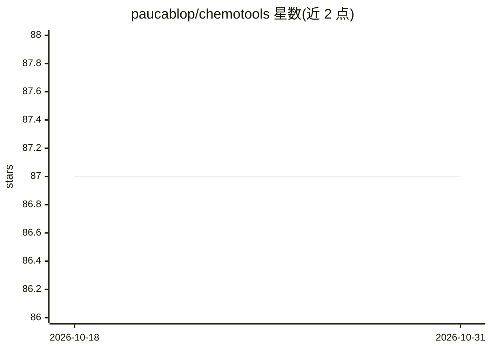

# paucablop/chemotools

⭐ 87 · Python · MIT · 推送 2026-10-29 · [GitHub](https://github.com/paucablop/chemotools) · [官网](https://chemotools.org/) · 个人维护

**scikit-learn 生态的光谱化学计量学预处理库**

Python 库 chemotools，将化学计量学预处理工具引入 scikit-learn 生态：提供光谱数据的模块化 transformer，覆盖基线校正、平滑、缩放、求导、散射校正等预处理，以及吸光度/透射率/反射率等物理单位转换和仪器间校准迁移方法（DS、PDS、x 轴插值）。所有组件兼容 scikit-learn 的 pipeline 与 transformer 接口，可直接嵌入机器学习工作流。通过 PyPI 与 Conda 发布，MIT 许可，支持 Python 3.10-3.14 兼容性测试矩阵。

## 筛选速览

| 维度 | 判定 | 备注 |
|---|---|---|
| AI 角色 | `ai-ecosystem` | LLM/agent 周边工具 |
| 许可风险 | `permissive` | MIT |
| 部署形态 | `library` | 以包/库形式分发 |
| 模型依赖 | — | README 未给出锁定关系 |
| 硬件要求 | — | 无带数字的原话,不猜 |
| 安装摩擦 | `low` | 无编译、无系统依赖或容器化 |
| 成熟度 | — | 结构信号不足 |

## 能力要点

- 光谱数据预处理 transformer（基线校正/平滑/缩放/求导/散射校正）
- 物理单位转换（吸光度、透射率、反射率、Kubelka-Munk 等）
- 仪器间校准迁移方法（DS、PDS、x 轴插值）
- 兼容 scikit-learn pipeline，PyPI 与 Conda 双渠道发布

## 适用场景

- 在 scikit-learn pipeline 中对 NIR/拉曼/红外光谱做预处理再建模
- 不同仪器间迁移校准模型
- 光谱物理量单位的批量转换

## 场景标签

 · 领域:化学计量学/光谱分析

## 证据(README 行号)

> L13: `chemotools` is a Python library that brings **chemometric preprocessing tools** into the `scikit-learn` ecosystem.
> L22: - Fully compatible with `scikit-learn` pipelines and transformers.

## 星数曲线

2026-10-18 87 → 2026-10-31 87（+0）

---
*卡片 v1 · prompt 1.4 · 生成 2026-10-23 · 置信度 high · 依据 README sha `8be5cd333e6f` · [字段定义](../../DATASET.md)*
