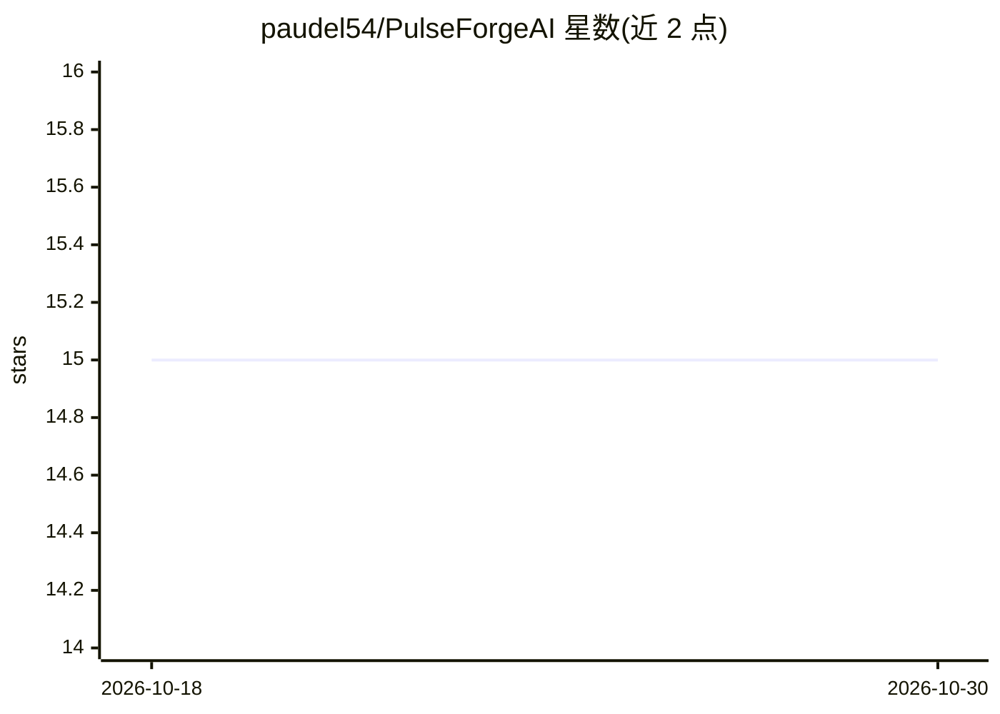

# paudel54/PulseForgeAI

⭐ 15 · Python · 推送 2026-03-30 · [GitHub](https://github.com/paudel54/PulseForgeAI) · [官网](https://pulse-forge-ai.vercel.app) · 个人维护

**院内心脏康复 AI 助手：可穿戴 ECG 数据转为临床洞察与患教**

面向院内心脏康复场景的 AI 副驾系统：经 BLE 读取 Polar H10 的 ECG/ACC 数据，通过双窗口信号处理管线提取可解释临床特征（HRV、QRS/QT 形态等），并由两个智能体协作——面向患者的 Nurse（Qwen3，含西班牙语）与面向临床医生的 Clinical Assistant（MedGemma-27B，SOAP 病历生成），RAG 检索 AHA/AACVPR 指南，配合四层确定性安全检查与参考队列匹配。概念验证部署于 Vercel+Ollama，生产目标为 NVIDIA DGX Spark 本地运行（零 PHI 出院）。自述为研究原型，非 FDA 批准的 SaMD。

## 筛选速览

| 维度 | 判定 | 备注 |
|---|---|---|
| AI 角色 | `ai-native` | 本体是模型或模型工具 |
| 许可风险 | `none` | — |
| 部署形态 | `library` | 以包/库形式分发 |
| 模型依赖 | local-ok | 支持本地模型 |
| 硬件要求 | — | 无带数字的原话,不猜 |
| 安装摩擦 | `low` | 无编译、无系统依赖或容器化 |
| 成熟度 | `idea` | |

## 能力要点

- 双窗口信号处理：5 秒/30 秒窗口提取 SQI、HRV、QRS/QT 形态等可解释指标
- 双智能体架构：患者端 Nurse（Qwen3）与临床端 Clinical Assistant（MedGemma-27B，SOAP 生成）
- 4 层确定性安全架构，关键警报不依赖 LLM
- 参考队列匹配（PhysioNet 数据集 + ECG-FM 768 维嵌入）与 Google Fit 纵向基线

## 适用场景

- 院内心脏康复训练中实时监测 Polar H10 生命体征并触发安全警报
- 临床医生基于 AHA/AACVPR 指南做 RAG 问答与 SOAP 病历生成
- 患者获得带健康框架护栏的康复陪伴对话（含西班牙语）
- 将患者指标与术后参考队列做可解释对比

## 场景标签

`AI 助手` `RAG` · 领域:对话与助手

## 证据(README 行号)

> L11: **Talk to Your Heart** solves the cardiac rehab supervision bottleneck with an AI copilot that runs **entirely on-c
> L38: - **Nurse Agent** (Qwen3): Patient-facing wellness companion with Spanish-language support. Strict wellness-framing
> L39: - **Clinical Assistant** (MedGemma-27B): Clinician-facing interactive Q&A and SOAP note generation. RAG-grounded in

## 星数曲线

2026-10-18 15 → 2026-10-30 15（+0）

---
*卡片 v1 · prompt 1.4 · 生成 2026-10-30 · 置信度 high · 依据 README sha `ae0d8f8b15ce` · [字段定义](../../DATASET.md)*
