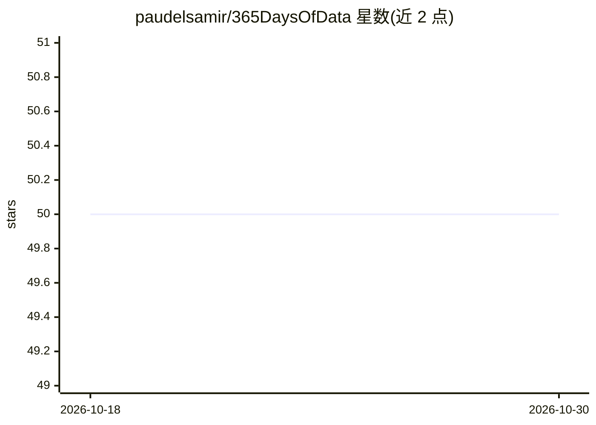

# paudelsamir/365DaysOfData

⭐ 50 · Jupyter Notebook · NOASSERTION · 推送 2025-12-26 · [GitHub](https://github.com/paudelsamir/365DaysOfData) · 个人维护

**个人 365 天数据/ML/DL 学习旅程记录：项目清单+逐日进度**

个人学习公开仓库：以 365 天挑战形式记录从线性代数、经典机器学习（回归、集成、聚类、降维）到深度学习（感知机、反向传播、CNN）的学习路径。包含约 10 个完成项目（足球运动员身价预测、电影推荐、猫狗分类、Seq2Seq 聊天机器人、从零实现 GPT、图像描述生成等），部分带 Live Demo 链接；另列出书籍课程完成状态与逐日学习条目（资源与主题对照）。README 未提供本仓库的安装或运行说明。

## 筛选速览

| 维度 | 判定 | 备注 |
|---|---|---|
| AI 角色 | `ai-knowledge` | 知识聚合/清单类 |
| 许可风险 | `none` | NOASSERTION |
| 部署形态 | `None` |  |
| 模型依赖 | — | README 未给出锁定关系 |
| 硬件要求 | — | 无带数字的原话,不猜 |
| 安装摩擦 | `low` | 无编译、无系统依赖或容器化 |
| 成熟度 | — | 结构信号不足 |

## 能力要点

- 约 10 个端到端 ML/DL 项目记录，多附 Live Demo
- 逐日学习日志（Day1 起）含主题与资源对照
- 覆盖从线性代数到深度学习、GenAI/AgenticAI 的课程清单

## 适用场景

- 参考他人的 ML/DL 学习路线与项目选题
- 查找各主题对应课程与教程资源
- 了解端到端项目（爬取→清洗→建模→部署）的实践过程

## 场景标签

`教程课程` · 领域:学习与行业

## 证据(README 行号)

> L13: > This journey is about AI from scratch with data, not my entire learning history. I’ll keep building in public whi
> L15: ## Projects Completed

## 星数曲线

2026-10-18 50 → 2026-10-30 50（+0）

---
*卡片 v1 · prompt 1.4 · 生成 2026-10-24 · 置信度 high · 依据 README sha `222a0a4720bd` · [字段定义](../../DATASET.md)*
