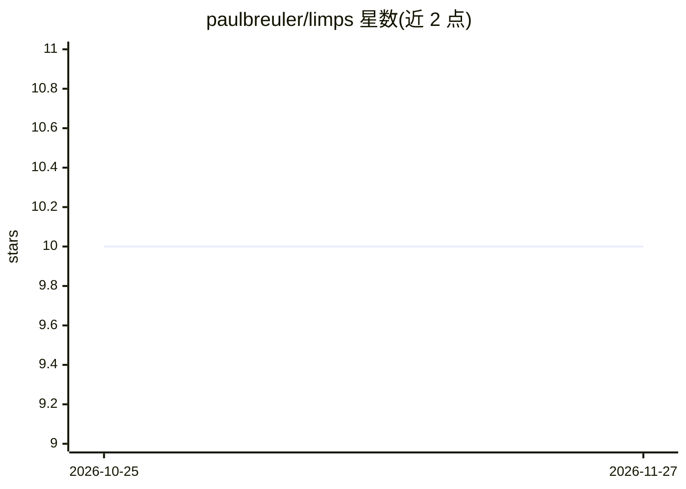

# paulbreuler/limps

⭐ 10 · TypeScript · MIT · 推送 2026-03-02 · [GitHub](https://github.com/paulbreuler/limps) · [官网](https://basestate.io) · 个人维护

**本地 MCP 规划服务器：为多个 AI 助手提供共享文档与规划层**

以 npm 包分发的本地 MCP 服务器，指向任意 Markdown 文件夹，提供文档 CRUD、全文搜索、计划/任务状态跟踪、任务评分与知识图谱（实体抽取、混合检索、冲突检测）。v3 仅支持 HTTP 传输，以后台守护进程运行，多个 MCP 客户端（Cursor、Claude Code、Claude Desktop、OpenAI Codex、ChatGPT 等）共享同一数据源。数据留在本地（SQLite 索引 + 文件），除 `version --check` 外不联网；用户 JavaScript 处理在 QuickJS 沙箱中限时限内存运行。

## 筛选速览

| 维度 | 判定 | 备注 |
|---|---|---|
| AI 角色 | `ai-ecosystem` | LLM/agent 周边工具 |
| 许可风险 | `permissive` | MIT |
| 部署形态 | `self-host` | docker 或自建部署 |
| 模型依赖 | — | README 未给出锁定关系 |
| 硬件要求 | — | 无带数字的原话,不猜 |
| 安装摩擦 | `low` | 无编译、无系统依赖或容器化 |
| 成熟度 | — | 结构信号不足 |

## 能力要点

- 任意 Markdown 文件夹的文档 CRUD 与全文搜索
- 计划/agent 工作流：状态跟踪、任务评分、下一任务建议
- 知识图谱：实体抽取、混合检索、冲突检测
- HTTP 守护进程支持多客户端共享同一 MCP 服务器实例

## 适用场景

- 让 Cursor、Claude、Codex 读取并更新同一份计划文档
- 团队把规划文档放在共享目录按代码方式审阅变更
- 本地优先管理 AI 辅助开发中的任务与决策记录
- 对任意索引目录做结构化文档检索与可编程处理

## 场景标签

`知识图谱` `知识库管理` · 领域:知识与检索

## 证据(README 行号)

> L3: **L**ocal **I**ntelligent **M**CP **P**lanning **S**erver — A document and planning layer for AI assistants. No subs
> L89: **The solution:** limps provides a standardized MCP interface that any tool can access. Your docs live in one place
> L236: limps v3 uses **HTTP transport exclusively** via a persistent daemon. This allows multiple MCP clients to share a 

## 星数曲线

2026-10-25 10 → 2026-11-27 10（+0）

---
*卡片 v1 · prompt 1.4 · 生成 2026-11-19 · 置信度 mid · 依据 README sha `95b834d1734c` · [字段定义](../../DATASET.md)*
