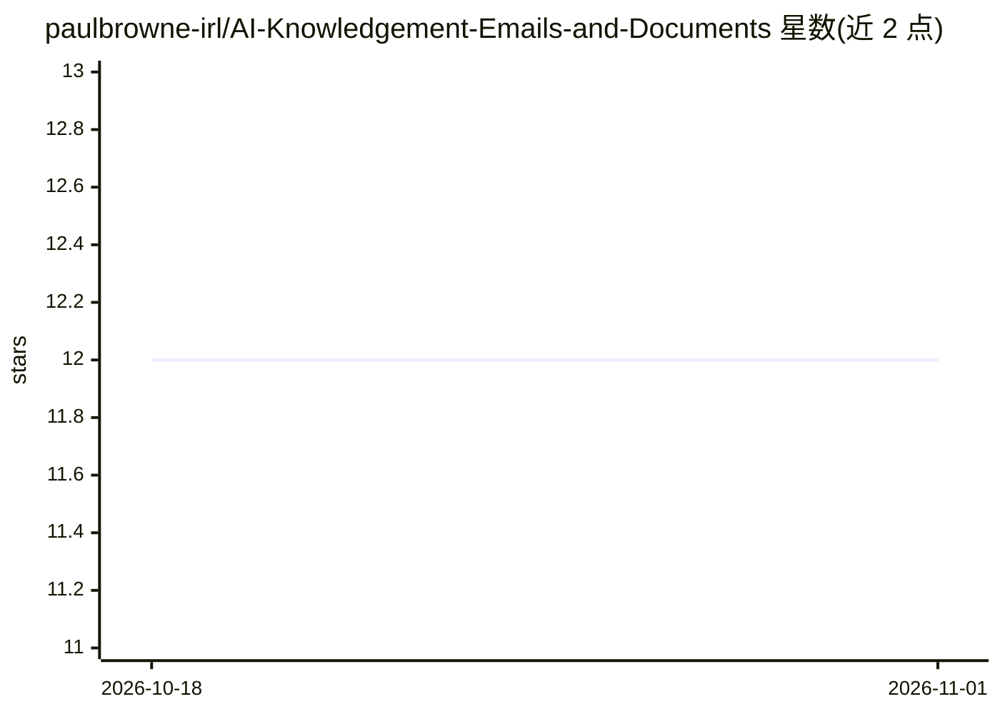

# paulbrowne-irl/AI-Knowledgement-Emails-and-Documents

⭐ 12 · Python · Apache-2.0 · 推送 2026-06-07 · [GitHub](https://github.com/paulbrowne-irl/AI-Knowledgement-Emails-and-Documents) · 个人维护

**面向企业内部知识问答的 RAG 聊天机器人与邮件自动应答原型**

在非营利 VC 场景落地的 RAG 知识管理原型：用 Elastic 做向量检索，LangChain 串联流程，支持本地 Llama（经 Ollama）或远程 LLM（Copilot/OpenAI/Gemini），Streamlit 提供 UI，另有可接入 Power Automate 的 Excel Bot 流程实现自动应答 Outlook 邮件。强调隐私默认：信息本地存储、LLM 本地运行、发送前脱敏，人可审核答案。安装需 Python 3.12+、Docker Compose 启动 Elastic/Kibana 等基础设施，运行 ingest 脚本索引 pdf/邮件/Word 文档后使用。

## 筛选速览

| 维度 | 判定 | 备注 |
|---|---|---|
| AI 角色 | `ai-native` | 本体是模型或模型工具 |
| 许可风险 | `permissive` | Apache-2.0 |
| 部署形态 | `self-host` | docker 或自建部署 |
| 模型依赖 | local-ok | 支持本地模型 |
| 硬件要求 | — | 无带数字的原话,不猜 |
| 安装摩擦 | `low` | 无编译、无系统依赖或容器化 |
| 成熟度 | — | 结构信号不足 |

## 能力要点

- Elastic 向量检索 + LangChain + 可切换本地/远程 LLM 的 RAG 流程
- 敏感信息发送给 LLM 前默认脱敏，人可审核（human-in-loop）
- Excel Bot 流程可接入 Power Automate 与 Office 365 实现邮件自动应答
- Docker Compose 一键启动 Elastic、Kibana、Ollama、OpenWebUI 等组件

## 适用场景

- 把内部文档变成可对话的知识库回答业务问题
- 自动起草并回复 Outlook 邮件，人工审核后发出
- 在处理敏感数据的企业内本地部署 RAG 问答系统

## 场景标签

`RAG` `文档问答` · 领域:知识与检索

## 证据(README 行号)

> L7: *RAG* (Retrieval Augmented Generation) AI techniques allow you and colleagues to have conversations with these docum
> L9: This project is code to implement a pilot RAG Chatbot in a not for profit VC. Given the community nature of the orga
> L24: 1. **Answer Key Business Questions** - Friendly User Interface to answer questions in a back and forward way, focus

## 星数曲线

2026-10-18 12 → 2026-11-01 12（+0）

---
*卡片 v1 · prompt 1.4 · 生成 2026-11-01 · 置信度 high · 依据 README sha `3ea7d306ebc4` · [字段定义](../../DATASET.md)*
