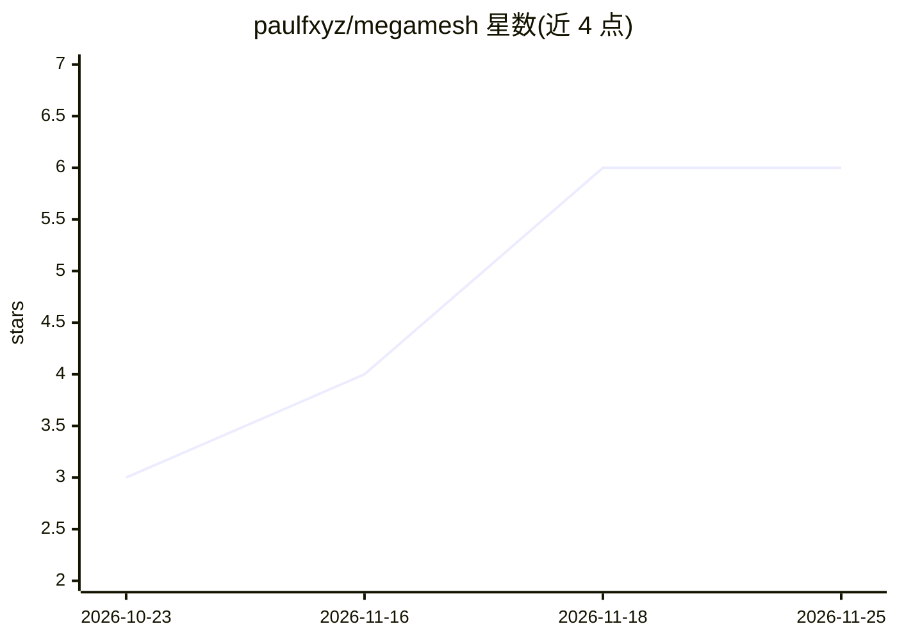

# paulfxyz/megamesh

⭐ 6 · Shell · MIT · 推送 2026-11-12 · [GitHub](https://github.com/paulfxyz/megamesh) · [官网](https://megamesh.sh) · 个人维护

**把 1GB VPS 一键部署为自托管 WireGuard VPN 的脚本**

提供三种部署方式：幂等 bash 脚本、可粘贴给能执行 SSH 命令的 AI agent 的 PROMPT.md，以及 megamesh.sh/deploy 网页部署器。部署内容包括 WireGuard 隧道（wg-easy v15 Web UI 与二维码）、Caddy 自动证书、firewalld 默认拒绝策略（仅开三个端口）、fail2ban、每周 topgrade 升级与健康检查回滚。支持 CentOS Stream 9、Ubuntu 24.04、Rocky 9.5、Debian 12 四个发行版，脚本可重复运行并保留既有配置。

## 筛选速览

| 维度 | 判定 | 备注 |
|---|---|---|
| AI 角色 | `ai-enhanced` | 去掉 AI 部分产品仍成立 |
| 许可风险 | `permissive` | MIT |
| 部署形态 | `self-host` | docker 或自建部署 |
| 模型依赖 | — | README 未给出锁定关系 |
| 硬件要求 | — | 无带数字的原话,不猜 |
| 安装摩擦 | `low` | 无编译、无系统依赖或容器化 |
| 成熟度 | — | 结构信号不足 |

## 能力要点

- 脚本/PROMPT/网页部署器三种形式交付同一程序
- firewalld 默认 DROP，仅开放 SSH、WireGuard、443 三个端口
- 每周 topgrade 升级 + 健康检查 + 镜像回滚
- 公开前由三个前沿模型审计，发现项记录于 docs/AUDIT.md

## 适用场景

- 在 1GB 内存 VPS 上自建个人 WireGuard VPN
- 让 AI agent 通过 SSH 代为完成服务器部署
- 带二维码 Web UI 管理多设备 VPN 配置

## 场景标签

 · 领域:网络/自托管工具

## 证据(README 行号)

> L17:  Renting a tunnel, you are a subscriber : a shared exit, a privacy policy you take on faith, a company you cannot a
> L25:  Paste <code>PROMPT.md</code> into any agent that can run shell commands over SSH. It carries the rules, the order 
> L40: It is written down three times — as a script that does it, as a prompt that teaches an agent to do it, and as a web

## 星数曲线

2026-10-23 3 → 2026-11-25 6（+3）

---
*卡片 v1 · prompt 1.4 · 生成 2026-11-20 · 置信度 mid · 依据 README sha `05d7a2872210` · [字段定义](../../DATASET.md)*
