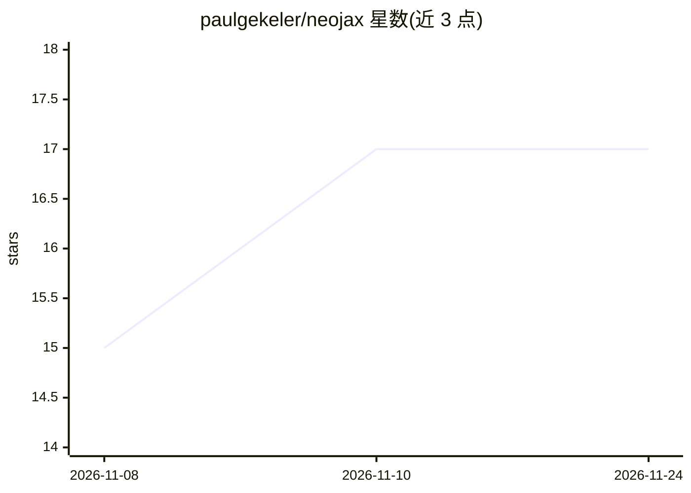

# paulgekeler/neojax

⭐ 17 · Python · Apache-2.0 · 推送 2026-11-14 · [GitHub](https://github.com/paulgekeler/neojax) · [官网](https://paulgekeler.github.io/neojax/) · 个人维护

**JAX/Equinox 上的神经算子库：求解 PDE 的模型实现**

基于 JAX 与 Equinox 从零实现的神经算子（Neural Operators）Python 库，起点为 PyTorch neuraloperator 库的移植后重写。提供 FNO、UNO、GeoFNO、DeepONet、Transolver 等 10 余种算子架构，以及训练编排、位置嵌入、Sobolev/Lp 损失、数据归一化与数据管道等工具；API 兼容 vmap/jit/grad。面向科学机器学习（SciML）研究者与开发者，作者声明项目处于早期阶段，可能出现破坏性变更，可用功能以清单为准。

## 筛选速览

| 维度 | 判定 | 备注 |
|---|---|---|
| AI 角色 | `ai-native` | 本体是模型或模型工具 |
| 许可风险 | `permissive` | Apache-2.0 |
| 部署形态 | `library` | 以包/库形式分发 |
| 模型依赖 | — | README 未给出锁定关系 |
| 硬件要求 | — | 无带数字的原话,不猜 |
| 安装摩擦 | `low` | 无编译、无系统依赖或容器化 |
| 成熟度 | `idea` | |

## 能力要点

- 实现 10 余种神经算子架构（FNO/UNO/GeoFNO/DeepONet/Transolver 等）
- JAX 原生实现，兼容 vmap/jit/grad 函数式变换
- 提供 Trainer/TrainState 训练编排与模型无关的 benchmark 模块
- W^{k,p} Sobolev 损失、Lp 损失与物理量纲归一化工具

## 适用场景

- 用神经算子做 PDE 求解与替代建模（如波动方程、Navier-Stokes）
- 在 JAX 生态中复现或扩展 Fourier Neural Operator 类模型
- 对神经算子模型做统一的基准测试与训练实验

## 场景标签

 · 领域:科学机器学习/PDE 求解

## 证据(README 行号)

> L9: **neojax** (**Ne**ural **O**perators in **JAX**) is an implementation of Neural Operators built on top of JAX and Eq

## 星数曲线

2026-11-08 15 → 2026-11-24 17（+2）

---
*卡片 v1 · prompt 1.4 · 生成 2026-11-18 · 置信度 high · 依据 README sha `31fe651700ce` · [字段定义](../../DATASET.md)*
