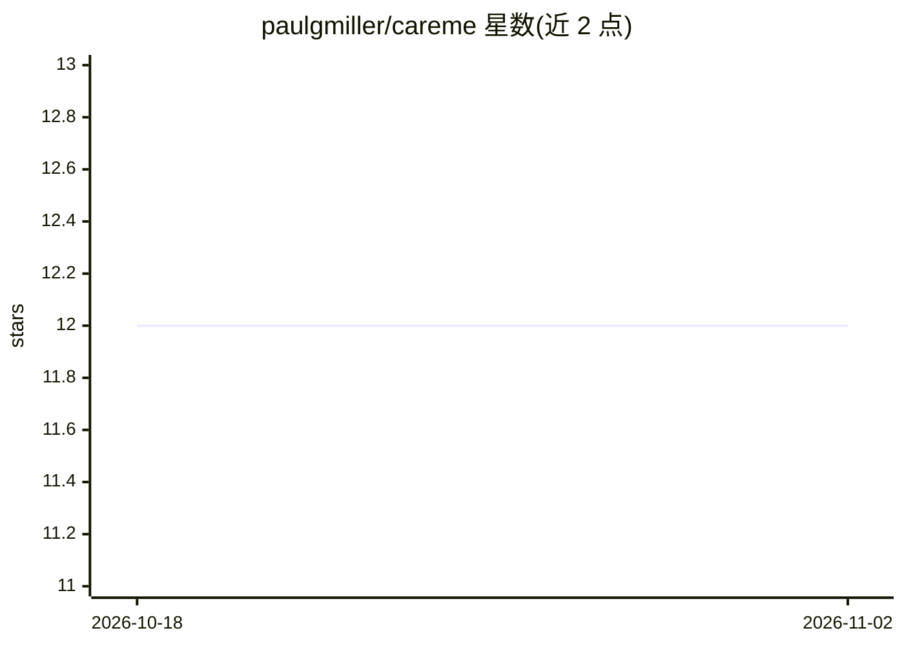

# paulgmiller/careme

⭐ 12 · Go · NOASSERTION · 推送 2026-11-01 · [GitHub](https://github.com/paulgmiller/careme) · [官网](https://careme.cooking) · 个人维护

**扫描本地超市库存并用 LLM 生成每周菜谱的 Web 应用**

Go 编写的服务端渲染 Web 应用：按用户位置选取食品店（Kroger、Albertsons 等），读取门店的肉类与当季农产品库存，调用 OpenAI API 生成多菜系、多烹饪风格的每周菜谱与配酒建议，并可经 Kroger 购物车接口转移购物清单、通过 SendGrid 邮件发送每周菜谱。面向消费者的网站 careme.cooking 的代码库，另含本地食材评分审核工具、缓存与 OpenTelemetry 可观测性配置。依赖多项外部 API 凭据（Kroger、AI_API_KEY 为必填）。

## 筛选速览

| 维度 | 判定 | 备注 |
|---|---|---|
| AI 角色 | `ai-native` | 本体是模型或模型工具 |
| 许可风险 | `none` | NOASSERTION |
| 部署形态 | `None` |  |
| 模型依赖 | locked-api |  |
| 硬件要求 | — | 无带数字的原话,不猜 |
| 安装摩擦 | `low` | 无编译、无系统依赖或容器化 |
| 成熟度 | — | 结构信号不足 |

## 能力要点

- 按门店库存生成每周菜谱与配酒建议
- Kroger 购物车转移与多商店 provider 插件式接入（locations→staples→ordering）
- SendGrid 每周菜谱邮件与 Azure Blob 缓存存储
- 本地食材评分审核工具（cmd/ingredientreview）

## 适用场景

- 根据我常去超市的实际库存获得每周菜谱
- 把生成的购物清单转移到 Kroger 购物车
- 通过邮件订阅每周菜谱

## 场景标签

`AI 写作` · 领域:内容生成

## 证据(README 行号)

> L4: 2. Check the stores inventory for fresh meat and seasonal produce
> L5: 3. Generate a weekly meal plan from a variety of cuisines and cooking styles.

## 星数曲线

2026-10-18 12 → 2026-11-02 12（+0）

---
*卡片 v1 · prompt 1.4 · 生成 2026-11-01 · 置信度 high · 依据 README sha `f4309d97d6da` · [字段定义](../../DATASET.md)*
