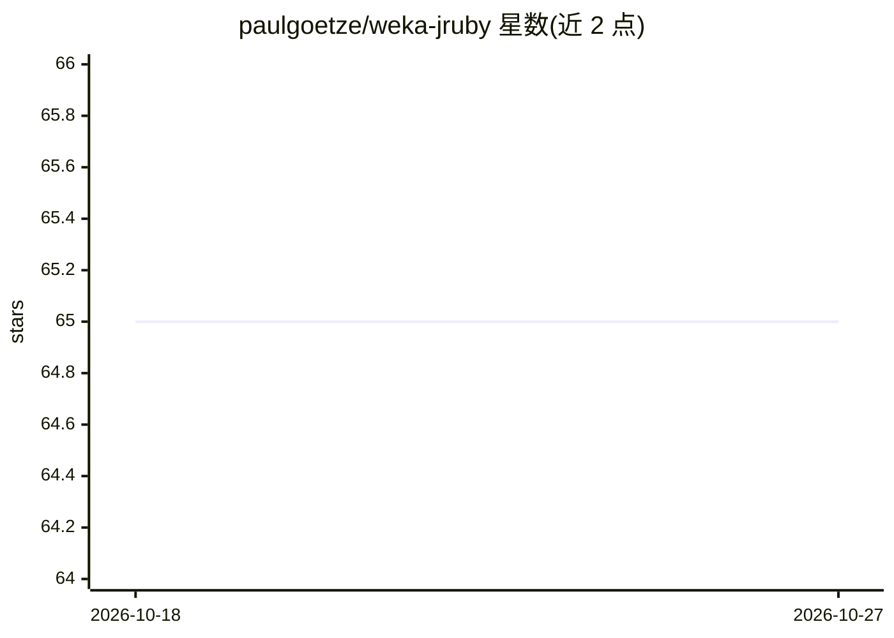

# paulgoetze/weka-jruby

⭐ 65 · Ruby · MIT · 推送 2026-06-24 · [GitHub](https://github.com/paulgoetze/weka-jruby) · 个人维护

**在 JRuby 中调用 Weka 机器学习与数据挖掘算法的 Ruby gem**

基于 Weka Java 库封装的 JRuby gem，将 Weka 的分类、聚类等机器学习与数据挖掘算法以 Ruby 命名空间形式提供，并对部分接口做了更符合 Ruby 风格的增强，同时保留 Weka 原有命名以便查阅 Weka 官方文档。面向希望用 Ruby/JRuby 做机器学习的开发者，通过 Gemfile 或 gem install 安装，详细用法与示例见项目 Wiki。

## 筛选速览

| 维度 | 判定 | 备注 |
|---|---|---|
| AI 角色 | `ai-native` | 本体是模型或模型工具 |
| 许可风险 | `permissive` | MIT |
| 部署形态 | `None` |  |
| 模型依赖 | — | README 未给出锁定关系 |
| 硬件要求 | — | 无带数字的原话,不猜 |
| 安装摩擦 | `low` | 无编译、无系统依赖或容器化 |
| 成熟度 | — | 结构信号不足 |

## 能力要点

- 在 JRuby 中通过 require 'weka' 使用 Weka 全套机器学习算法
- 保留 Weka 命名空间，可直接对照 Weka 文档查类与功能
- 对部分接口做了 Ruby 风格的接口增强

## 适用场景

- 在 Ruby/JRuby 项目中直接调用 Weka 的分类与聚类算法
- 用 Ruby 语法做数据挖掘原型与实验

## 场景标签

`数据分析` · 领域:效率与自动化

## 证据(README 行号)

> L6: Machine Learning & Data Mining with JRuby based on the
> L7: Weka Java library.
> L27: Use Weka's Machine Learning and Data Mining algorithms by requiring the gem:

## 星数曲线

2026-10-18 65 → 2026-10-27 65（+0）

---
*卡片 v1 · prompt 1.4 · 生成 2026-10-24 · 置信度 high · 依据 README sha `aa54aac2fc68` · [字段定义](../../DATASET.md)*
