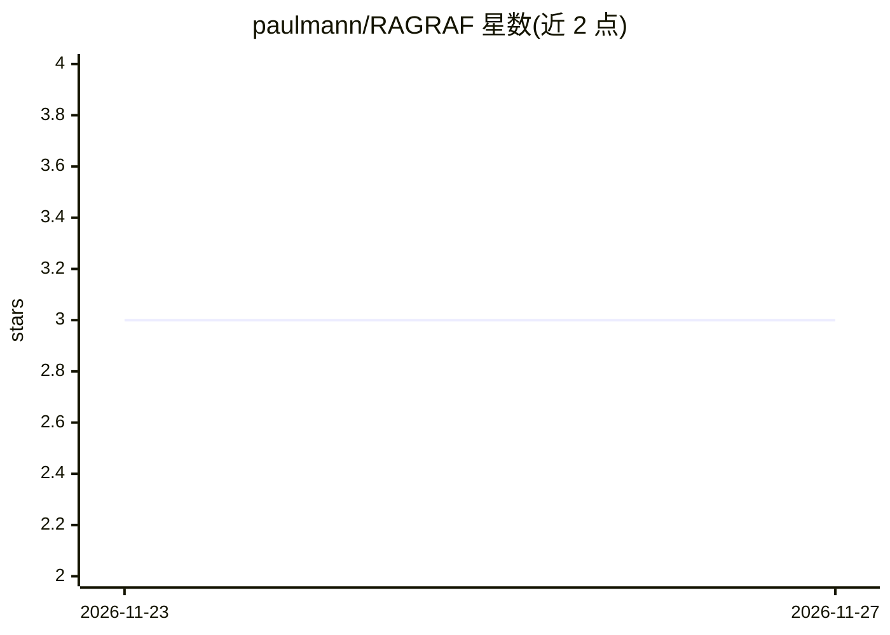

# paulmann/RAGRAF

⭐ — · [GitHub]() · 个人维护

**面向 LLM agent 的本地代码知识库 MCP 服务器：定位/调用/影响分析**

RAGRAF 将源码索引为图与向量的知识库，通过 MCP 协议以 94 个工具暴露给 agent，回答'在哪定义、谁调用、改动影响什么'等问题，每个事实附带 file:line 引证；完全本地运行（Python 3.13+、SQLite+FTS5、tree-sitter、本地 embeddings）。支持 29 种语言解析，87 个固定操作（搜索、死代码、入口点、影响分析等），另有 pro/enterprise 版本提供质量循环、团队索引、密钥代理等扩展功能；可选 Java+Joern 图层解锁切片能力。

## 筛选速览

| 维度 | 判定 | 备注 |
|---|---|---|
| AI 角色 | `ai-ecosystem` | LLM/agent 周边工具 |
| 许可风险 | `none` | — |
| 部署形态 | `self-host` | docker 或自建部署 |
| 模型依赖 | — | README 未给出锁定关系 |
| 硬件要求 | — | 无带数字的原话,不猜 |
| 安装摩擦 | `low` | 无编译、无系统依赖或容器化 |
| 成熟度 | — | 结构信号不足 |

## 能力要点

- 94 个 MCP 工具 + CLI 双入口，全部本地离线运行
- 每个事实带 file:line 引证，可验证性 100%
- 29 种语言解析为语法树（PHP/Python/Java/Go/Rust 等）
- 混合检索：BM25 词法 + 向量 + 文档图实体双层匹配

## 适用场景

- 让 coding agent 精确定位函数定义与调用方，减少全文件阅读
- 改动前评估影响面（impact/slice/write_check）
- 检测重复文件、死代码与索引漂移
- 跨会话记录决策笔记与事实记忆

## 场景标签

`知识图谱` `RAG` `语义搜索` · 领域:知识与检索

## 证据(README 行号)

> L10: RAGRAF — graph-and-vector knowledge base over source code for LLM agents: 94 MCP tools, verifiable facts as file:li
> L16: An assistant that answers an agent's questions about a codebase — *where is it, who calls it, what breaks if I chan
> L94: The same operations are exposed as **94 MCP tools** (`ragraf_*`) — for attachment to an agent as a server — and thr

## 星数曲线

2026-11-23 3 → 2026-11-27 3（+0）

---
*卡片 v1 · prompt 1.4 · 生成 2026-11-23 · 置信度 low · 依据 README sha `b0eabcea30ff` · [字段定义](../../DATASET.md)*
