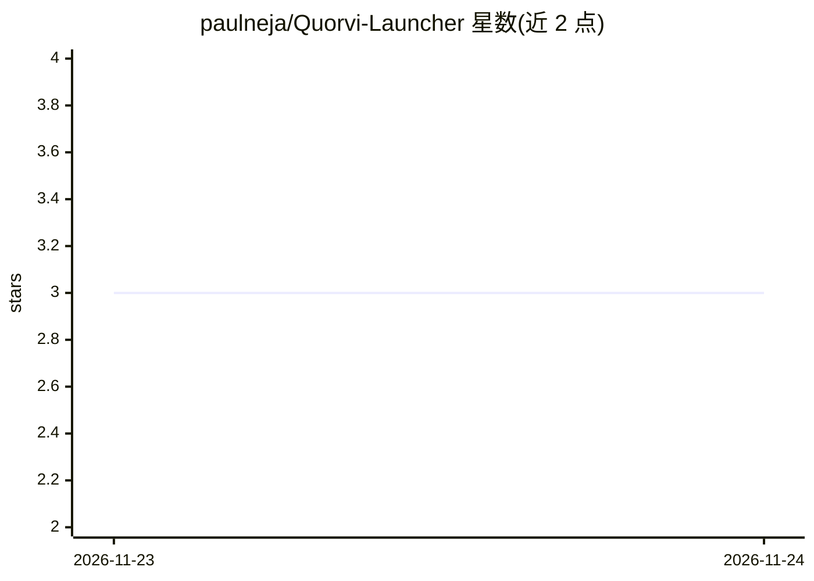

# paulneja/Quorvi-Launcher

⭐ 3 · Kotlin · GPL-3.0 · 推送 2026-10-12 · [GitHub](https://github.com/paulneja/Quorvi-Launcher) · 个人维护

**Android 启动器：内置 AI 助手、Unix 终端与连接面板**

基于 Kotlin/Jetpack Compose 的 Android 启动器，主打液态玻璃界面、离线优先的日常启动体验。内置 Nexo AI 助手（流式回答、工具、记忆、附件与图像生成）、捆绑 Termux 包的 Unix 终端，以及 GitHub/SSH/Docker/Home Assistant 等连接面板；代理任务提供运行日志、审批与紧急停止开关。构建需 JDK 21 与 Android SDK 平台 37，通过 Gradle 打包、adb 安装；Nexo 可在设置中整体关闭。

## 筛选速览

| 维度 | 判定 | 备注 |
|---|---|---|
| AI 角色 | `ai-enhanced` | 去掉 AI 部分产品仍成立 |
| 许可风险 | `viral` | GPL-3.0 |
| 部署形态 | `None` |  |
| 模型依赖 | — | README 未给出锁定关系 |
| 硬件要求 | — | 无带数字的原话,不猜 |
| 安装摩擦 | `medium` | 含编译或系统依赖之一 |
| 成熟度 | — | 结构信号不足 |

## 能力要点

- 内置 Nexo 助手：流式回答、工具、记忆与图像生成，可在设置中整体关闭
- 捆绑 Termux 包的 Unix 终端，运行在独立进程
- 连接面板聚合 GitHub、SSH、Docker、Home Assistant、GitLab 等
- 代理任务带运行/步骤/DAG/日志/工件、审批与 kill switch

## 适用场景

- 把 Android 主屏换成可深度定制的液态玻璃启动器
- 在手机上直接使用终端与 apt 包管理
- 通过 Nexo 或定时胶囊在手机上运行代理任务并审批结果
- 一个手势查看 GitHub 通知、SSH 主机与家庭自动化状态

## 场景标签

`AI 助手` `图像生成` · 领域:对话与助手

## 证据(README 行号)

> L24: - **AI is optional:** one switch in Settings turns Nexo off entirely; the launcher, terminal and connections keep w
> L3: An Android launcher that doubles as an operations console and a home for autonomous agents. Quorvi keeps the everyda

## 星数曲线

2026-11-23 3 → 2026-11-24 3（+0）

---
*卡片 v1 · prompt 1.4 · 生成 2026-11-23 · 置信度 high · 依据 README sha `c73a2804fb7f` · [字段定义](../../DATASET.md)*
