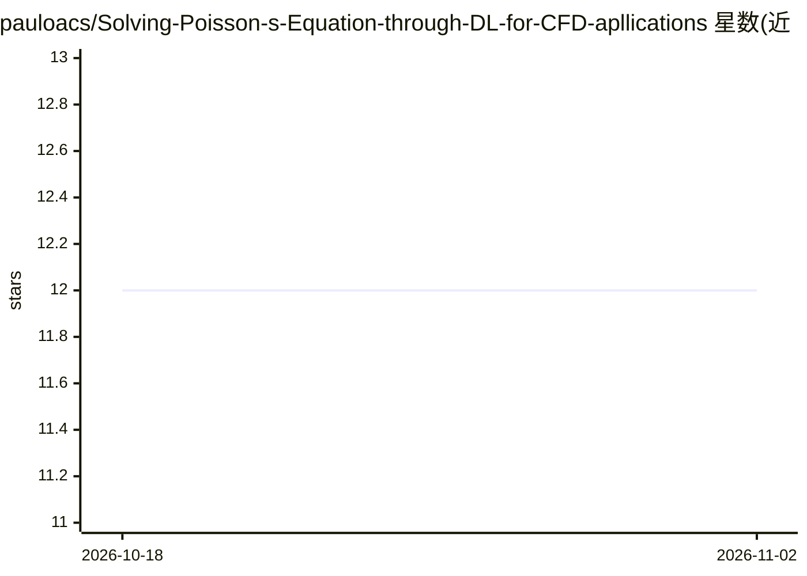

# pauloacs/Solving-Poisson-s-Equation-through-DL-for-CFD-apllications

⭐ 12 · C++ · MIT · 推送 2026-01-15 · [GitHub](https://github.com/pauloacs/Solving-Poisson-s-Equation-through-DL-for-CFD-apllications) · 个人维护

**用深度学习求解 CFD 压力泊松方程的代理模型代码库**

包含硕士论文实现与后续改进两部分：以深度学习代理模型求解 CFD 中的压力泊松方程（PISO 算法环节），后续工作引入两个额外框架以改进泛化与精度。配套的 DLpisoFoam 仓库（另一仓库）提供可在 OPENFOAM 求解器中使用这些代理模型的实现。README 指明最新版本已迁移至 DLpisoFoam 仓库，本仓库代码需按各子目录 README 指引运行，附两篇已发表论文链接。MIT 许可。

## 筛选速览

| 维度 | 判定 | 备注 |
|---|---|---|
| AI 角色 | `ai-native` | 本体是模型或模型工具 |
| 许可风险 | `permissive` | MIT |
| 部署形态 | `None` |  |
| 模型依赖 | — | README 未给出锁定关系 |
| 硬件要求 | — | 无带数字的原话,不猜 |
| 安装摩擦 | `low` | 无编译、无系统依赖或容器化 |
| 成熟度 | — | 结构信号不足 |

## 能力要点

- 深度学习代理模型求解压力泊松方程
- 含硕士论文实现与后续改进（引入两个新框架）
- 配套 DLpisoFoam 仓库将代理模型接入 OPENFOAM CFD 求解器
- 附两篇已发表论文（Springer/ScienceDirect）

## 适用场景

- 研究 ML 代理模型在 CFD 压力方程求解中的应用
- 复现论文实验结果并对比改进框架
- 为自建 OpenFOAM 求解器集成此类代理模型做参考

## 场景标签

 · 领域:科学计算/计算流体力学

## 证据(README 行号)

> L5: This repository contains the code and resources related to solving Poisson's equation through deep learning for comp
> L26:  - This paper contains a deep description of the ML Surrogate Model developed to solve the Pressure Poisson Equatio

## 星数曲线

2026-10-18 12 → 2026-11-02 12（+0）

---
*卡片 v1 · prompt 1.4 · 生成 2026-11-01 · 置信度 high · 依据 README sha `71ef92ef26f1` · [字段定义](../../DATASET.md)*
