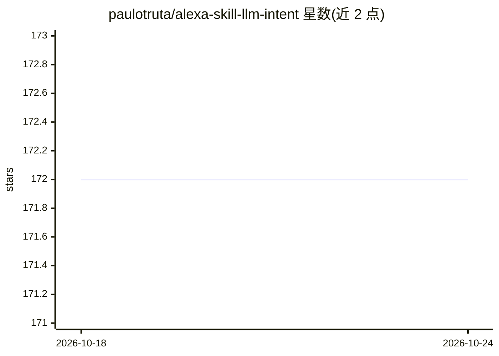

# paulotruta/alexa-skill-llm-intent

⭐ 172 · Python · MIT · 推送 2025-11-20 · [GitHub](https://github.com/paulotruta/alexa-skill-llm-intent) · 个人维护

**让 Alexa 语音助手接入 LLM 对话问答的 Skill 模板**

一个 Alexa Skill 模板：部署后用户可通过 Alexa 设备以语音提问，由 OpenAI API 兼容的 LLM 提供商（OpenAI/Anthropic/OpenRouter 等）生成回答，经 Alexa 语音播报。配置 invocation name、llm_url、llm_model、llm_key 即可使用，支持把请求代理为 webhook POST 调用。提供三种部署方式：Makefile 管理 Alexa Hosted Skill、Developer Console 手动导入 zip、ask CLI 高级部署。面向有 Alexa Developer Account 的开发者。

## 筛选速览

| 维度 | 判定 | 备注 |
|---|---|---|
| AI 角色 | `ai-native` | 本体是模型或模型工具 |
| 许可风险 | `permissive` | MIT |
| 部署形态 | `library` | 以包/库形式分发 |
| 模型依赖 | — | README 未给出锁定关系 |
| 硬件要求 | — | 无带数字的原话,不猜 |
| 安装摩擦 | `low` | 无编译、无系统依赖或容器化 |
| 成熟度 | — | 结构信号不足 |

## 能力要点

- 对接任意 OpenAI API schema 兼容的 LLM 提供商（含 webhook 代理模式）
- Makefile 自动化创建/导入/更新 Alexa Hosted Skill 目标
- 支持 make dialog / make debug 的对话模型与 Lambda 调试
- 提供默认 system prompt，可通过配置覆盖

## 适用场景

- 给自己的 Alexa 设备加上 LLM 问答能力
- 以模板为基础快速搭建并发布自定义 LLM Alexa Skill
- 在 Alexa Developer Console 或本地多目标管理多个 LLM 技能

## 场景标签

`语音 Agent` · 领域:对话与助手

## 证据(README 行号)

> L5: An Alexa Skill template that gives you a ready to use skill to start a turn conversation with an AI. Ask a question 
> L25: - **`llm_url` ->** OpenAI OpenAPI Schema Compatible LLM API provider url

## 星数曲线

2026-10-18 172 → 2026-10-24 172（+0）

---
*卡片 v1 · prompt 1.4 · 生成 2026-10-22 · 置信度 mid · 依据 README sha `091df10b36de` · [字段定义](../../DATASET.md)*
