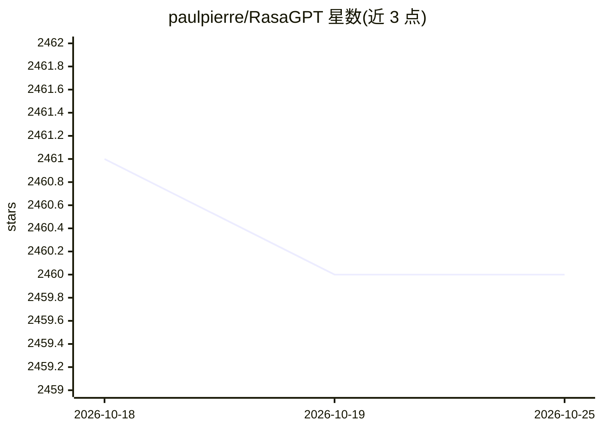

# paulpierre/RasaGPT

⭐ 2,460 · Python · MIT · 推送 2025-11-12 · [GitHub](https://github.com/paulpierre/RasaGPT) · [官网](https://rasagpt.dev) · 个人维护

**基于 Rasa+Langchain 的无头 LLM 聊天机器人平台参考实现**

开发者向的 boilerplate 与参考实现：在 Rasa 对话框架之上集成 Langchain/LlamaIndex 做文档索引、检索与上下文注入，用 FastAPI+SQLModel 提供自有 API 端点，pgvector 存储与相似度检索，ngrok 反向代理对接 Telegram 渠道。安装流程经 Makefile + Docker compose 自动化（初始化数据库、训练 Rasa 模型、配置 webhook）。作者声明该项目远离生产代码、存在提示注入与安全漏洞，检索仅用 1000 字符分块与欧氏距离，质量未优化。

## 筛选速览

| 维度 | 判定 | 备注 |
|---|---|---|
| AI 角色 | `ai-ecosystem` | LLM/agent 周边工具 |
| 许可风险 | `permissive` | MIT |
| 部署形态 | `self-host` | docker 或自建部署 |
| 模型依赖 | — | README 未给出锁定关系 |
| 硬件要求 | — | 无带数字的原话,不猜 |
| 安装摩擦 | `low` | 无编译、无系统依赖或容器化 |
| 成熟度 | `idea` | |

## 能力要点

- Rasa 与 Langchain/LlamaIndex 集成，LLM fallback 到对话流水线
- FastAPI 文档上传、版本管理与自动重训练
- pgvector 自定义 schema 的嵌入存储与相似度检索
- Docker compose + Makefile 一键安装，支持 MacOS M1/M2

## 适用场景

- 作为 Rasa 接入 LLM 的二次开发起点
- 搭建基于自有文档语料的 Telegram 问答机器人
- 学习多租户聊天机器人后端的架构组织方式

## 场景标签

`聊天机器人` `文档问答` · 领域:对话与助手

## 证据(README 行号)

> L5: 💬 RasaGPT is the first headless LLM chatbot platform built on top of Rasa and Langchain. It is boilerplate and a ref
> L27: - Creating your own proprietary bot end-point using FastAPI, document upload and “training” 'pipeline included
> L28: - How to integrate Langchain/LlamaIndex and Rasa

## 星数曲线

2026-10-18 2,461 → 2026-10-25 2,460（-1）

---
*卡片 v1 · prompt 1.4 · 生成 2026-10-21 · 置信度 high · 依据 README sha `0ef84568dd0e` · [字段定义](../../DATASET.md)*
