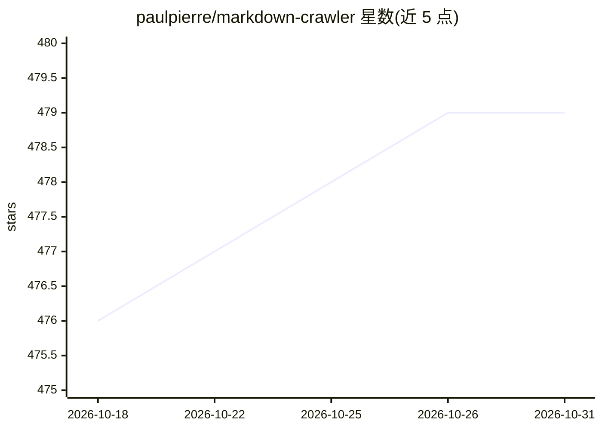

# paulpierre/markdown-crawler

⭐ 479 · Python · MIT · 推送 2026-06-26 · [GitHub](https://github.com/paulpierre/markdown-crawler) · [官网](https://pypi.org/project/markdown-crawler/) · 个人维护

**多线程网站爬虫：整站爬取并转为 Markdown，供 RAG 用**

基于 Python 的多线程网页爬虫，递归爬取网站并将每个页面转换为独立的 Markdown 文件，主要面向 LLM 文档解析场景，简化大文档在 RAG 中的分块与处理。用 BeautifulSoup 解析 HTML、markdownify 转换格式，支持线程数、爬取深度、有效/排除路径、CSS 选择器定位、标题风格等配置，可从上次中断处继续。以 pip 包提供 CLI 与 Python 库两种用法，附 60 个测试（覆盖率 95%）。

## 筛选速览

| 维度 | 判定 | 备注 |
|---|---|---|
| AI 角色 | `ai-ecosystem` | LLM/agent 周边工具 |
| 许可风险 | `permissive` | MIT |
| 部署形态 | `library` | 以包/库形式分发 |
| 模型依赖 | — | README 未给出锁定关系 |
| 硬件要求 | — | 无带数字的原话,不猜 |
| 安装摩擦 | `low` | 无编译、无系统依赖或容器化 |
| 成熟度 | — | 结构信号不足 |

## 能力要点

- 多线程爬取并可从中断处继续
- 支持 max_depth、valid/exclude paths、domain/base_path 匹配、CSS target 选择器
- 每页生成一个 Markdown 文件，保留文档结构与表格/图片
- 提供 CLI 与 Python 库两种用法，60 个测试（95% 覆盖率）

## 适用场景

- 把整站文档转成 Markdown 构建 RAG 语料库
- 生成大语料用于 LLM 微调前处理（如提取 Q&A 对）
- 为 agent 构建领域知识语料（如游戏/影视知识库）

## 场景标签

`网页抓取` `文档解析` · 领域:效率与自动化

## 证据(README 行号)

> L10: It was primarily created for large language model document parsing to simplify chunking and processing of large doc
> L46: - RAG (retrieval augmented generation) - my primary usecase, use this to normalize large documents and chunk by hea

## 星数曲线

2026-10-18 476 → 2026-10-31 479（+3）

---
*卡片 v1 · prompt 1.4 · 生成 2026-10-21 · 置信度 high · 依据 README sha `16e66edbd267` · [字段定义](../../DATASET.md)*
