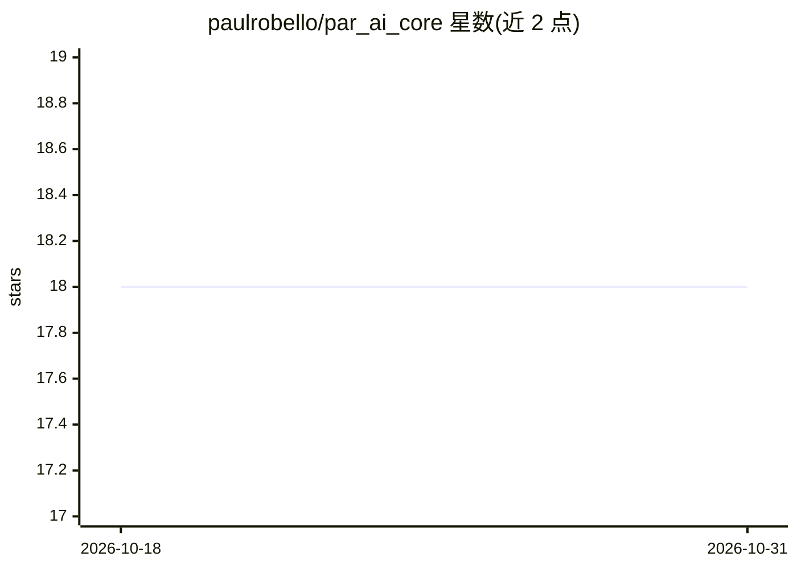

# paulrobello/par_ai_core

⭐ 18 · Python · MIT · 推送 2026-07-10 · [GitHub](https://github.com/paulrobello/par_ai_core) · 个人维护

**基于 LangChain 的 LLM 接入 Python 工具库，统一多模型调用**

构建在 LangChain 之上的 Python 库，提供统一接口配置与管理多家 LLM 提供商（OpenAI、Anthropic、Ollama、LlamaCpp、Gemini、Groq、Mistral、DeepSeek、Bedrock、Azure、OpenRouter、LiteLLM 等），支持同步与异步调用、工具调用处理、上下文收集、多种输出格式与可选成本追踪。采用可选 extras 安装，仅装所需后端；除 Ollama/LlamaCpp/LiteLLM 外需配置对应 API key，另支持任何 OpenAI 兼容端点。面向开发者，需 Python 3.11+。

## 筛选速览

| 维度 | 判定 | 备注 |
|---|---|---|
| AI 角色 | `ai-ecosystem` | LLM/agent 周边工具 |
| 许可风险 | `permissive` | MIT |
| 部署形态 | `library` | 以包/库形式分发 |
| 模型依赖 | local-ok | 支持本地模型 |
| 硬件要求 | — | 无带数字的原话,不猜 |
| 安装摩擦 | `low` | 无编译、无系统依赖或容器化 |
| 成熟度 | — | 结构信号不足 |

## 能力要点

- 统一接口配置多家 LLM 提供商，支持同步/异步调用
- 可选 extras 按需安装后端（openai/anthropic/web/search/pricing/all）
- 上下文收集、工具调用处理与 JSON/CSV/表格输出工具
- 支持 OpenAI 兼容端点接入未列出的提供商

## 适用场景

- 在项目中以统一接口切换多家 LLM 提供商
- 本地 Ollama/LlamaCpp 无 key 调用模型
- 为 LLM 应用做成本追踪与输出格式化

## 场景标签

`模型网关` · 领域:Agent 开发

## 证据(README 行号)

> L17: Par AI Core is a Python library that provides a set of tools, helpers, and wrappers built on top of LangChain.
> L19: to interact with various Large Language Models (LLMs) and related services. This library serves as the foundation

## 星数曲线

2026-10-18 18 → 2026-10-31 18（+0）

---
*卡片 v1 · prompt 1.4 · 生成 2026-10-29 · 置信度 high · 依据 README sha `d66b95ca2f98` · [字段定义](../../DATASET.md)*
