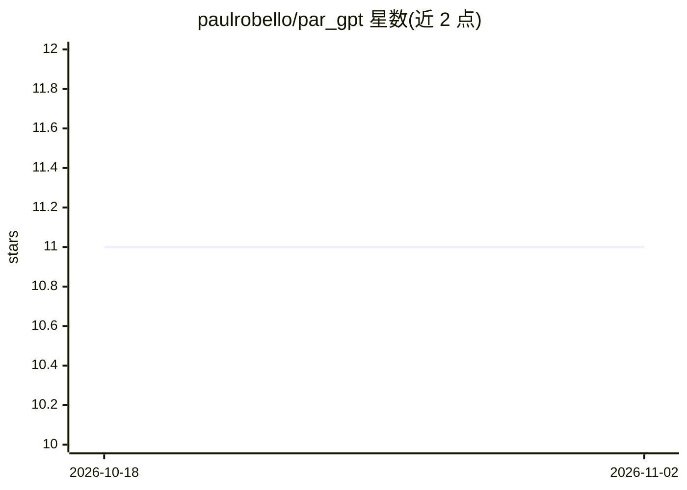

# paulrobello/par_gpt

⭐ 11 · Python · MIT · 推送 2026-10-20 · [GitHub](https://github.com/paulrobello/par_gpt) · 个人维护

**多模型 CLI 工具：命令行调用各类 LLM 与可执行工具的 Agent 模式**

基于 Python/Typer 的命令行 LLM 工具，支持 basic LLM 模式与带动态工具的 agent 模式，可接入 OpenAI、Anthropic、Groq、Google、Ollama、LlamaCpp、Bedrock、OpenRouter、Mistral、XAI、LiteLLM 等 provider，其中 Ollama 与 LlamaCpp 无需 API key。上下文来源支持 stdin/文件/URL/网页搜索，输出格式可为 Markdown/CSV/JSON，并含 Docker 沙箱代码执行、TTS、Redis 记忆、模型回退与定价显示等机制。README 自述为进行中的项目，可能随时 break。需 Python 3.12+ 与 UV 包管理器安装。

## 筛选速览

| 维度 | 判定 | 备注 |
|---|---|---|
| AI 角色 | `ai-native` | 本体是模型或模型工具 |
| 许可风险 | `permissive` | MIT |
| 部署形态 | `None` |  |
| 模型依赖 | local-ok | 支持本地模型 |
| 硬件要求 | — | 无带数字的原话,不猜 |
| 安装摩擦 | `medium` | 含编译或系统依赖之一 |
| 成熟度 | `idea` | |

## 能力要点

- basic LLM 模式与含动态工具、最大迭代控制的 agent 模式
- 12 种 AI provider 可选，Ollama/LlamaCpp 免 API key，支持回退模型
- 上下文来源支持 stdin/文件/URL/网页搜索，输出格式 md/csv/json
- Docker 沙箱代码执行、TTS、Redis 记忆、定价显示

## 适用场景

- 在终端里向多种云端或本地模型提问并定制输出格式
- 用 agent 模式让模型调用工具并在沙箱中执行代码
- 在 provider 或模型之间切换与回退，统一 CLI 工作流

## 场景标签

`模型网关` `AI 助手` · 领域:Agent 开发

## 证据(README 行号)

> L5: A flexible command-line interface for interacting with various AI language models, supporting multiple providers and
> L17: * Can be run in basic LLM mode or agent mode that can use tools

## 星数曲线

2026-10-18 11 → 2026-11-02 11（+0）

---
*卡片 v1 · prompt 1.4 · 生成 2026-11-01 · 置信度 high · 依据 README sha `988024d48dfa` · [字段定义](../../DATASET.md)*
