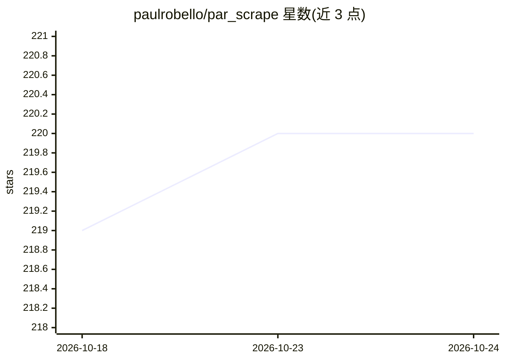

# paulrobello/par_scrape

⭐ 220 · Python · MIT · 推送 2026-07-12 · [GitHub](https://github.com/paulrobello/par_scrape) · 个人维护

**AI 辅助网页抓取与结构化数据提取命令行工具**

基于 Playwright/Selenium 抓取网页并转为 Markdown，再调用 LLM（基于 PAR AI Core）按用户指定字段生成 pydantic 结构化输出，可存为 JSON/CSV/Excel/Markdown。支持单页/单层/同域三种爬取模式，爬取状态持久化在 SQLite 可断点续爬；提供 --if-changed 内容哈希增量提取与 --prune 内容剪枝以降低 token 消耗。需 Python 3.11+，经 uv/pipx 从 PyPI 安装，接入十余家 AI 提供商，Ollama/LlamaCpp/LiteLLM 无需 API key。限制：分页爬取模式未实现，OpenAI 以外提供商效果不稳定。

## 筛选速览

| 维度 | 判定 | 备注 |
|---|---|---|
| AI 角色 | `ai-native` | 本体是模型或模型工具 |
| 许可风险 | `permissive` | MIT |
| 部署形态 | `library` | 以包/库形式分发 |
| 模型依赖 | local-ok | 支持本地模型 |
| 硬件要求 | — | 无带数字的原话,不猜 |
| 安装摩擦 | `low` | 无编译、无系统依赖或容器化 |
| 成熟度 | — | 结构信号不足 |

## 能力要点

- Playwright/Selenium 抓取 + LLM 按字段结构化提取（pydantic 模型约束输出）
- 三种爬取模式，SQLite 持久化队列支持断点续爬与 CLI 管理
- --if-changed 按 Markdown SHA-256 增量复用历史提取结果，跳过未变页面
- --prune 剪枝导航/页脚等样板内容，文档页可降 30-60% 输入 token

## 适用场景

- 抓取网页并让 AI 提取指定字段为 JSON/CSV/Excel
- 批量爬取整个域名下的页面并结构化入库
- 无 AI 模式下批量抓取并转换为干净 Markdown

## 场景标签

`网页抓取` `文档解析` · 领域:效率与自动化

## 证据(README 行号)

> L11: PAR Scrape is a versatile web scraping tool with options for Selenium or Playwright, featuring AI-powered data extr
> L21: - AI-powered data extraction and formatting

## 星数曲线

2026-10-18 219 → 2026-10-24 220（+1）

---
*卡片 v1 · prompt 1.4 · 生成 2026-10-22 · 置信度 high · 依据 README sha `7b91b43d9038` · [字段定义](../../DATASET.md)*
