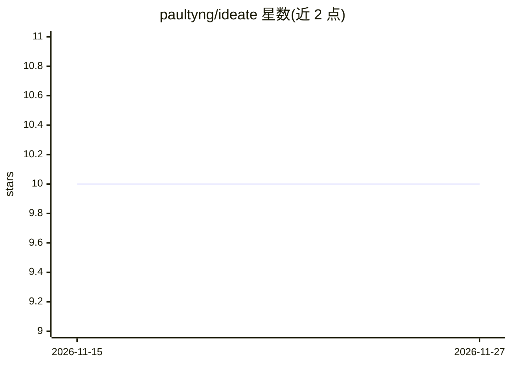

# paultyng/ideate

⭐ 10 · Go · MIT · 推送 2026-11-26 · [GitHub](https://github.com/paultyng/ideate) · 个人维护

**给个人开发者的本地优先 macOS 创意/在途工作管理桌面应用**

以“idea（创意）”为单位的本地优先桌面应用：每个创意对应一个目录，聚合以 worktree 形式链接的仓库、上下文文件、外部资源与 AI agent 会话。通过注入的 MCP 服务器让 agent 会话调用工具，agent 可经 MCP 请求 diff 或 Markdown 评审并在应用内行内回复。提供预签名 .dmg 安装包与源码构建两条途径，附 CLI 子命令经 Unix socket 与运行中的应用通信。仅支持 macOS，v0.1 预览版。

## 筛选速览

| 维度 | 判定 | 备注 |
|---|---|---|
| AI 角色 | `ai-enhanced` | 去掉 AI 部分产品仍成立 |
| 许可风险 | `permissive` | MIT |
| 部署形态 | `desktop` | 安装包/桌面程序 |
| 模型依赖 | — | README 未给出锁定关系 |
| 硬件要求 | — | 无带数字的原话,不猜 |
| 安装摩擦 | `low` | 无编译、无系统依赖或容器化 |
| 成熟度 | `idea` | |

## 能力要点

- 每创意目录：worktree 链接仓库、上下文文件、资源与会话归一处
- agent 经注入的 MCP 服务器调用工具，评审请求在应用内行内完成
- 单一二进制 CLI，经 Unix socket 与运行中的应用交互
- 资源类型可插拔，覆盖文档、issue 跟踪、CI、可观测性等

## 适用场景

- 按创意组织多个仓库的在途开发工作与会话
- 在应用内对 agent 产出的 diff 或文档做行内评审
- 把文档、issue 跟踪、CI 等外部系统作为类型化资源挂到创意上

## 场景标签

`知识库管理` · 领域:知识与检索

## 证据(README 行号)

> L8: Each idea is a directory — linked repos as worktrees, context files, external resources, and AI agent sessions, all 
> L96: See CLAUDE.md for the architecture overview, data model, and resolved decisions. Short version: each idea is a dire

## 星数曲线

2026-11-15 10 → 2026-11-27 10（+0）

---
*卡片 v1 · prompt 1.4 · 生成 2026-11-19 · 置信度 high · 依据 README sha `fe5be371338b` · [字段定义](../../DATASET.md)*
