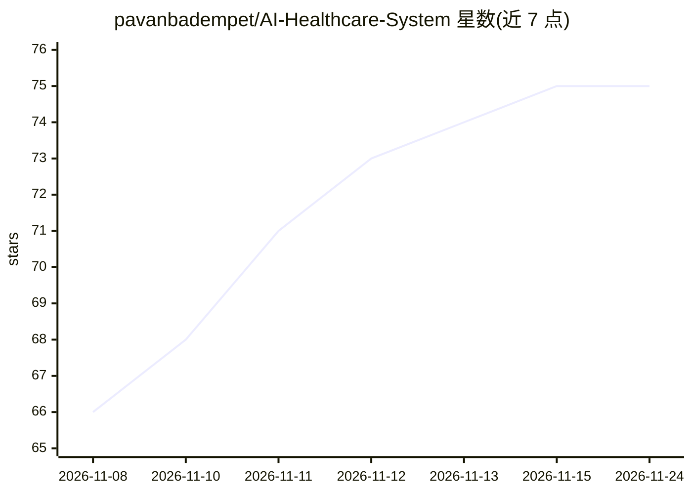

# pavanbadempet/AI-Healthcare-System

⭐ 75 · Python · AGPL-3.0 · 推送 2026-11-09 · [GitHub](https://github.com/pavanbadempet/AI-Healthcare-System) · [官网](https://pavanbadempet.github.io/AI-Healthcare-System/) · 个人维护

**面向医疗数据的 Databricks 湖仓与临床决策支持平台**

分布式医疗数据平台兼临床决策支持系统：基于 Databricks Unity Catalog Medallion 架构（Bronze/Silver/Gold），用 PySpark 4.3、Delta Lake 4.x、Parquet 2.0 处理 150 万+ 患者事件记录，实现 SCD Type 2 历史维度追踪与 Airflow DAG 编排。AI 部分包括多 Agent RAG 语义检索（Neon pgvector + HNSW 索引）、TabICLv2 表格基础模型风险评分（95% 共形区间 + SHAP 归因），并提供 FastAPI 后端与 React 19 临床门户。支持 Docker Compose 一键部署或本地 Python 环境运行，AGPLv3 许可，由个人维护。

## 筛选速览

| 维度 | 判定 | 备注 |
|---|---|---|
| AI 角色 | `ai-ecosystem` | LLM/agent 周边工具 |
| 许可风险 | `viral` | AGPL-3.0 |
| 部署形态 | `self-host` | docker 或自建部署 |
| 模型依赖 | — | README 未给出锁定关系 |
| 硬件要求 | — | 无带数字的原话,不猜 |
| 安装摩擦 | `low` | 无编译、无系统依赖或容器化 |
| 成熟度 | — | 结构信号不足 |

## 能力要点

- Medallion 三层湖仓管线（PySpark 4.3 / Delta Lake 4.x Liquid Clustering / SCD Type 2）
- 基于 Neon pgvector + HNSW 的多 Agent RAG 语义检索与缓存压缩
- TabICLv2 表格基础模型风险评分，95% 共形预测区间与 SHAP 归因
- Docker Compose 一键部署 FastAPI 后端 + React 19 临床门户

## 适用场景

- 医院构建 EHR/ICU 遥测数据的湖仓分析管线
- 临床医生在门户中查看实时生命体征与风险评分
- 搭建符合 OMOP CDM v5.4 标准的临床特征存储

## 场景标签

`Agent 框架` `多智能体` `RAG` · 领域:Agent 开发

## 证据(README 行号)

> L35: **AI Healthcare Data Lakehouse & Clinical Intelligence Platform** is a distributed data platform and clinical decis
> L41: * **Sub-100ms Multi-Agent RAG**: High-throughput semantic retrieval pipeline integrating distributed embeddings, lo
> L103: ### 3. Multimodal Diagnostics Hub (TabICLv2 + 95% Conformal Sets + SHAP)

## 星数曲线

2026-11-08 66 → 2026-11-24 75（+9）

---
*卡片 v1 · prompt 1.4 · 生成 2026-11-18 · 置信度 high · 依据 README sha `ed0b6a1a3c57` · [字段定义](../../DATASET.md)*
