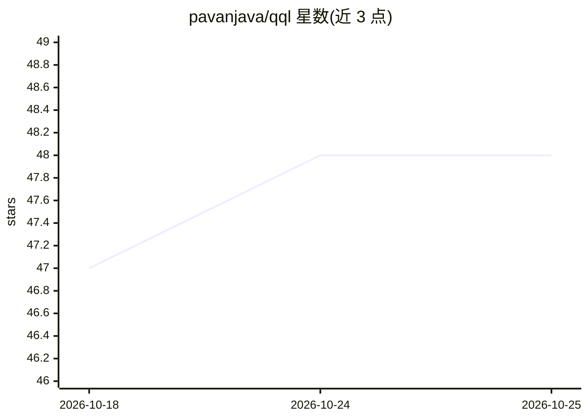

# pavanjava/qql

⭐ 48 · Python · MIT · 推送 2026-06-13 · [GitHub](https://github.com/pavanjava/qql) · [官网](https://pavanjava.github.io/qql) · 个人维护

**面向 Qdrant 向量库的 SQL 风查询语言与 CLI**

在 Qdrant Python 客户端之上的薄转换层：用 SQL 风格语句（INSERT/SELECT/SEARCH/SCROLL/RECOMMEND/UPDATE/DELETE/CREATE COLLECTION）替代 SDK 调用。插入时经 Fastembed 自动把 text 转为稠密向量，混合模式（USING HYBRID）同时生成稀疏 BM25 向量并以 Qdrant 默认 RRF（可切换 DBSF）融合检索；支持 GROUP BY、cross-encoder 重排、四种量化、SQL 风格 WHERE 过滤、脚本执行与集合 dump/restore。提供交互式 CLI 与 Python 程序化 API（Connection/run_query）。要求 Python 3.12+ 与运行中的 Qdrant 实例。

## 筛选速览

| 维度 | 判定 | 备注 |
|---|---|---|
| AI 角色 | `ai-ecosystem` | LLM/agent 周边工具 |
| 许可风险 | `permissive` | MIT |
| 部署形态 | `library` | 以包/库形式分发 |
| 模型依赖 | — | README 未给出锁定关系 |
| 硬件要求 | — | 无带数字的原话,不猜 |
| 安装摩擦 | `low` | 无编译、无系统依赖或容器化 |
| 成熟度 | — | 结构信号不足 |

## 能力要点

- SQL 风格语句覆盖 Qdrant 增删改查与集合管理
- Fastembed 自动向量化，混合稠密+稀疏 BM25 检索（RRF/DBSF 融合）
- GROUP BY 分组检索、cross-encoder 重排、四种量化方式
- 提供 CLI 与 Python 程序化 API（Connection / run_query）

## 适用场景

- 用熟悉的 SQL 语法操作 Qdrant 向量库，降低 SDK 学习成本
- 在 Python 应用中以内嵌 API 执行语义搜索与混合检索
- RAG 场景下批量插入文档并做混合检索与重排

## 场景标签

`语义搜索` `RAG` · 领域:知识与检索

## 证据(README 行号)

> L3: > SQL-like query language and CLI for Qdrant vector database.
> L21: QQL is a thin translation layer between a SQL-like query language and the Qdrant Python client. Every statement you

## 星数曲线

2026-10-18 47 → 2026-10-25 48（+1）

---
*卡片 v1 · prompt 1.4 · 生成 2026-10-25 · 置信度 high · 依据 README sha `c14245ef2a28` · [字段定义](../../DATASET.md)*
