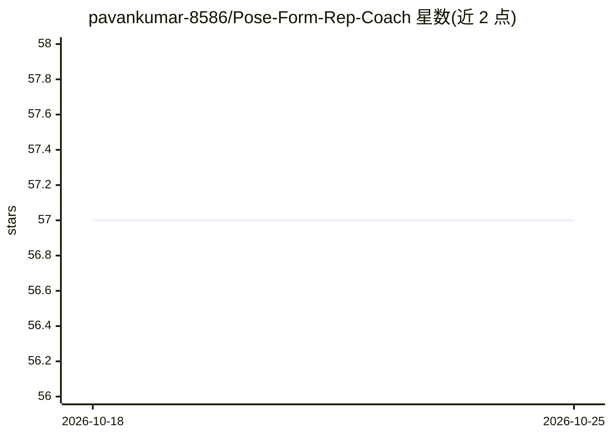

# pavankumar-8586/Pose-Form-Rep-Coach

⭐ 57 · HTML · 推送 2026-10-25 · [GitHub](https://github.com/pavankumar-8586/Pose-Form-Rep-Coach) · 个人维护

**用摄像头做实时动作识别的居家健身计数与姿势纠错应用**

基于 OpenCV 与 MediaPipe 的虚拟健身教练应用：从摄像头画面估计人体骨骼关键点，通过基于角度的有限状态机识别二头弯举、深蹲、俯卧撑等 7 种动作的完整次数并计数，姿势偏离安全范围时在界面上给出纠正提示；提供训练数据面板、多语言界面（英/印地/西/法/德/日）、低光增强与离线运行模式，视频帧不写盘。面向居家健身用户，需 Python 环境并从源码或发布包运行。README 声明为非医疗设备，计数仅供参考。

## 筛选速览

| 维度 | 判定 | 备注 |
|---|---|---|
| AI 角色 | `ai-native` | 本体是模型或模型工具 |
| 许可风险 | `permissive` | — |
| 部署形态 | `desktop` | 安装包/桌面程序 |
| 模型依赖 | — | README 未给出锁定关系 |
| 硬件要求 | — | 无带数字的原话,不猜 |
| 安装摩擦 | `low` | 无编译、无系统依赖或容器化 |
| 成熟度 | — | 结构信号不足 |

## 能力要点

- MediaPipe 姿态估计 + 角度状态机实现 7 种动作的自动次数计数
- 实时姿势纠正提示与训练会话分析面板
- 6 种语言的界面与低光增强模式
- 模型权重本地化后可离线运行，视频帧不写入磁盘

## 适用场景

- 居家力量训练时用摄像头自动数次数
- 深蹲、俯卧撑等动作中实时获得姿势纠正提示
- 查看每组的次数、节奏与动作幅度统计

## 场景标签

`图像视频处理` · 领域:感知与多模态

## 证据(README 行号)

> L6: **An OpenCV + MediaPipe powered virtual coach that turns your webcam into a personal strength-training studio.**
> L21: The AI Virtual Gym Trainer observes your body through a standard camera feed, estimates skeletal landmarks using Me

## 星数曲线

2026-10-18 57 → 2026-10-25 57（+0）

---
*卡片 v1 · prompt 1.4 · 生成 2026-10-24 · 置信度 high · 依据 README sha `3b4502c7e422` · [字段定义](../../DATASET.md)*
