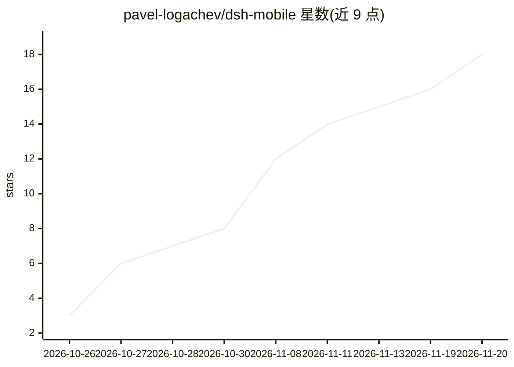

# pavel-logachev/dsh-mobile

⭐ 18 · Kotlin · MIT · 推送 2026-11-18 · [GitHub](https://github.com/pavel-logachev/dsh-mobile) · [官网](https://github.com/pavel-logachev/dsh-mobile/releases/latest) · 个人维护

**安卓手机远程操控电脑上 DeepSeek Harness agent 的客户端**

Android 应用（Kotlin/Jetpack Compose）配合电脑端的 Node.js 伴侣插件：通过 QR 码配对，经 Wi-Fi、Tailscale 或自建中继以 HTTPS 连接，模型与订阅留在电脑上，无云服务器。手机端可浏览所有项目的对话、指派任务（附带照片/文件，最多 20 个附件共 200 MiB）、实时读回复、在 agent 运行中插话（Steer）、回答 agent 提问、改模型与重命名、接收任务完成通知。要求 Android 8.0+、电脑 Windows、DSH 0.2.0-rc.2 以上与 Node.js 24。项目为非官方、独立于 DeepSeek 开发。

## 筛选速览

| 维度 | 判定 | 备注 |
|---|---|---|
| AI 角色 | `ai-ecosystem` | LLM/agent 周边工具 |
| 许可风险 | `permissive` | MIT |
| 部署形态 | `None` |  |
| 模型依赖 | — | README 未给出锁定关系 |
| 硬件要求 | — | 无带数字的原话,不猜 |
| 安装摩擦 | `medium` | 含编译或系统依赖之一 |
| 成熟度 | — | 结构信号不足 |

## 能力要点

- QR 码配对，Wi-Fi/Tailscale/自建中继直连，无云服务器
- 手机端指派任务并附带照片/文件（单条最多 20 个附件共 200 MiB）
- Steer 在不中断当前回合的情况下向 agent 传达消息；可回答 agent 提问
- 手机发起任务的通知（完成/失败/需回答）

## 适用场景

- 离开电脑时用手机给 DeepSeek Harness agent 派活并跟进回复
- 随时回答 agent 的提问、追加指示或停止运行
- 把现场照片和文件直接发给 agent 处理

## 场景标签

`编码 Agent` · 领域:编码与开发

## 证据(README 行号)

> L11: **Your DeepSeek Harness agent runs on your computer. From your Android phone you assign tasks with photos and files
> L107: A companion plugin is installed on the computer. It opens a narrow API to the paired phone over a secure connectio
> L118: The Android client is written in Kotlin and Jetpack Compose; the plugin runs on Node.js. Your own relay is an opti

## 星数曲线

2026-10-26 3 → 2026-11-20 18（+15）

---
*卡片 v1 · prompt 1.4 · 生成 2026-11-18 · 置信度 high · 依据 README sha `b3e6e41e1afe` · [字段定义](../../DATASET.md)*
