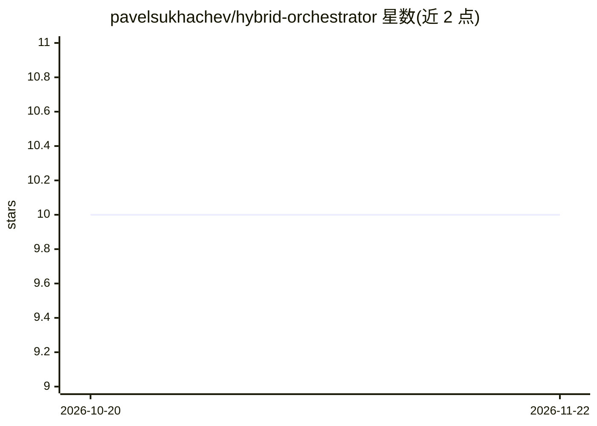

# pavelsukhachev/hybrid-orchestrator

⭐ 10 · Python · Apache-2.0 · 推送 2026-08-15 · [GitHub](https://github.com/pavelsukhachev/hybrid-orchestrator) · 个人维护

**人机协作编排模式参考实现：金融/保险场景协调 AI 代理与人工**

提取自保险语音 AI 生产系统的设计模式参考实现，包含四个模式：SQLite 会话状态外置实现跨会话延续、按紧急程度路由消息到多通道、基于用户行为触发的干预监控、AI 到人工坐席的升级转接。以 Python 库形式提供，含 Orchestrator/Trigger/Channel 组件、五种触发器类型与 webhook/email 通道实现（voice/SMS/slack 等通道未实现）。README 明确声明非生产就绪、无对照实验验证、仅 SQLite 存储、仅覆盖保险域单案例。

## 筛选速览

| 维度 | 判定 | 备注 |
|---|---|---|
| AI 角色 | `ai-ecosystem` | LLM/agent 周边工具 |
| 许可风险 | `permissive` | Apache-2.0 |
| 部署形态 | `None` |  |
| 模型依赖 | — | README 未给出锁定关系 |
| 硬件要求 | — | 无带数字的原话,不猜 |
| 安装摩擦 | `low` | 无编译、无系统依赖或容器化 |
| 成熟度 | — | 结构信号不足 |

## 能力要点

- 四种人机协作设计模式：状态外置、多通道路由、行为触发监控、人工升级转接
- 五种触发器类型（无活动/字段错误/字段变更/状态变更/自定义）
- Webhook 通道内置 SSRF 防护：强制 HTTPS、私网 IP 屏蔽、域名白名单
- 附研究论文 paper/main.md 与 BibTeX 引用条目

## 适用场景

- 保险/金融流程中 AI 代理处理业务、复杂情况转人工坐席
- 检测用户长时间无操作或反复报错并触发人工介入
- 为语音 AI 系统设计会话状态持久化与多通道通知

## 场景标签

`多智能体` `工作流自动化` · 领域:Agent 开发

## 证据(README 行号)

> L13: A **reference implementation** of design patterns for hybrid human-AI systems:
> L15: 1. **Session State Externalization** - Store agent state in SQLite for cross-session continuity
> L18: 4. **Human Escalation Pathways** - Enable smooth handoff from AI to human agents

## 星数曲线

2026-10-20 10 → 2026-11-22 10（+0）

---
*卡片 v1 · prompt 1.4 · 生成 2026-11-19 · 置信度 high · 依据 README sha `51e8f60dd76b` · [字段定义](../../DATASET.md)*
