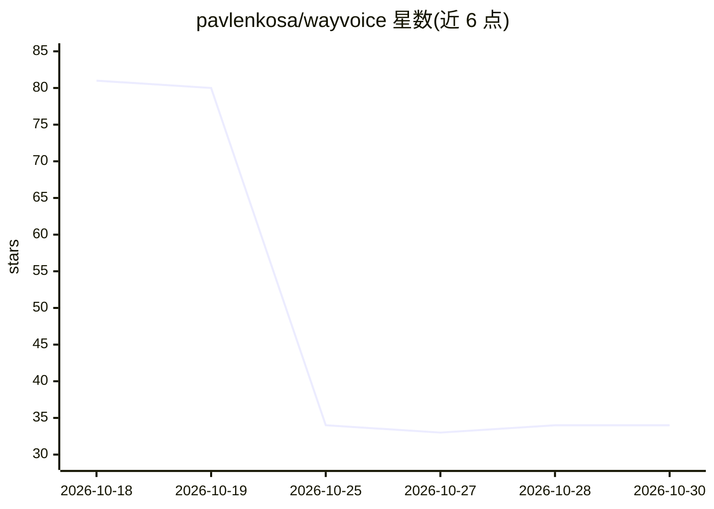

# pavlenkosa/wayvoice

⭐ 34 · Python · AGPL-3.0 · 推送 2026-10-25 · [GitHub](https://github.com/pavlenkosa/wayvoice) · 个人维护 · 中文 README

**Linux/Wayland 离线语音输入工具：按键说话即出文字**

面向 Linux Wayland 桌面用户的离线语音输入应用：按下快捷键录音，通过本地 Faster-Whisper 或 whisper.cpp 模型识别为文字，经 Wayland 剪贴板送达当前应用，可选自动粘贴；另有实验性 CPU Parakeet v3 引擎。模型需首次显式下载准备，识别过程全程离线、无需云端。基于 GTK4/libadwaita 构建，提供 10 种界面语言（含简体中文）。状态为 Alpha，桌面支持以 GNOME 为主，KDE/wlroots 仍在验证中。

## 筛选速览

| 维度 | 判定 | 备注 |
|---|---|---|
| AI 角色 | `ai-native` | 本体是模型或模型工具 |
| 许可风险 | `viral` | AGPL-3.0 |
| 部署形态 | `None` |  |
| 模型依赖 | — | README 未给出锁定关系 |
| 硬件要求 | — | 无带数字的原话,不猜 |
| 安装摩擦 | `low` | 无编译、无系统依赖或容器化 |
| 成熟度 | `idea` | |

## 能力要点

- 本地 Faster-Whisper 与 whisper.cpp 识别，可选常驻识别器
- Wayland 剪贴板投递与可选自动粘贴（可配合 ydotool）
- 显式模型准备流程：进度、取消、存储管理，不做隐式下载
- 实验性 CPU Parakeet v3，自动检测 25 种模型语言，共 100 种识别语言选项

## 适用场景

- 在 Linux 桌面上离线听写文字到任意应用
- 注重隐私、不依赖云端的语音输入
- 跨语言（最多 100 种）语音转文字听写

## 场景标签

`语音识别` · 领域:感知与多模态

## 证据(README 行号)

> L5: **Private, offline voice typing for Linux.** Press a shortcut. Speak. Keep typing.
> L35: - Local Faster-Whisper and whisper.cpp recognition; optional warm recognizer.

## 星数曲线

2026-10-18 81 → 2026-10-30 34（-47）

---
*卡片 v1 · prompt 1.4 · 生成 2026-10-24 · 置信度 high · 依据 README sha `b87077c2754e` · [字段定义](../../DATASET.md)*
