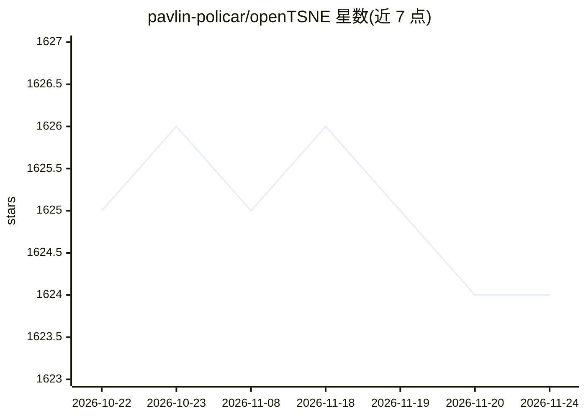

# pavlin-policar/openTSNE

⭐ 1,625 · Python · BSD-3-Clause · 推送 2026-11-18 · [GitHub](https://github.com/pavlin-policar/openTSNE) · [官网](https://opentsne.rtfd.io) · 个人维护

**给数据分析师提供并行加速的 t-SNE 降维嵌入 Python 库**

模块化的 t-SNE Python 实现，用于高维数据可视化降维。整合 t-SNE 算法最新改进：支持向已有嵌入添加新数据点、可扩展至数百万数据点的加速实现（默认 FIt-SNE，另有 Barnes-Hut），以及改善全局对齐的多尺度核技巧。通过 conda-forge 或 PyPI 安装，源码安装需 C/C++ 编译器（支持 OpenMP 方可多线程），可选安装 FFTW3 提升 FFT 性能。提供文档、教程与四组示例，配套 2024 年论文。BSD-3-Clause 许可。

## 筛选速览

| 维度 | 判定 | 备注 |
|---|---|---|
| AI 角色 | `ai-native` | 本体是模型或模型工具 |
| 许可风险 | `permissive` | BSD-3-Clause |
| 部署形态 | `library` | 以包/库形式分发 |
| 模型依赖 | — | README 未给出锁定关系 |
| 硬件要求 | — | 无带数字的原话,不猜 |
| 安装摩擦 | `low` | 无编译、无系统依赖或容器化 |
| 成熟度 | — | 结构信号不足 |

## 能力要点

- 支持向已有嵌入添加新数据点（transform 能力）
- 实现 FIt-SNE 与 Barnes-Hut 两种高效 t-SNE 算法，可扩展至数百万数据点
- 多尺度核技巧改善全局对齐
- 并行实现，需编译器支持 OpenMP 以启用多线程

## 适用场景

- 单细胞转录组等高维生物数据的二维可视化
- 数十万至百万级样本的加速降维嵌入
- 将新样本映射到已有的 t-SNE 嵌入空间

## 场景标签

 · 领域:机器学习/数据可视化

## 证据(README 行号)

> L5: openTSNE is a modular Python implementation of t-Distributed Stochasitc Neighbor Embedding (t-SNE) [1]_, a popular d
> L53: in the root directory to install the appropriate dependencies and compile the necessary binary files.
> L55: Please note that openTSNE requires a C/C++ compiler to be available on the system.

## 星数曲线

2026-10-22 1,625 → 2026-11-24 1,624（-1）

---
*卡片 v1 · prompt 1.4 · 生成 2026-11-23 · 置信度 high · 依据 README sha `1e33814d7e50` · [字段定义](../../DATASET.md)*
