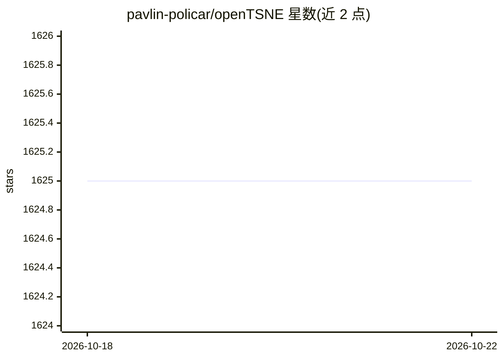

# pavlin-policar/openTSNE

⭐ 1,625 · Python · BSD-3-Clause · 推送 2026-10-18 · [GitHub](https://github.com/pavlin-policar/openTSNE) · [官网](https://opentsne.rtfd.io) · 组织维护

**t-SNE 降维算法的模块化 Python 实现库**

提供 t-SNE 降维算法的并行、可扩展 Python 实现，用于高维数据可视化。纳入多项算法改进：向已有嵌入添加新数据点、多线程与 Barnes-Hut/FIt-SNE 两种高效实现以扩展到百万级数据点、多尺度核技巧改善全局结构对齐。通过 conda-forge 与 PyPI 安装；从源码安装需系统有 C/C++ 编译者（OpenMP 用于多线程），FFTW3 为可选加速依赖。面向数据分析与单细胞转录组等场景的开发者与科研用户，附文档、教程与示例。

## 筛选速览

| 维度 | 判定 | 备注 |
|---|---|---|
| AI 角色 | `ai-native` | 本体是模型或模型工具 |
| 许可风险 | `permissive` | BSD-3-Clause |
| 部署形态 | `library` | 以包/库形式分发 |
| 模型依赖 | — | README 未给出锁定关系 |
| 硬件要求 | — | 无带数字的原话,不猜 |
| 安装摩擦 | `low` | 无编译、无系统依赖或容器化 |
| 成熟度 | — | 结构信号不足 |

## 能力要点

- Barnes-Hut 与 FIt-SNE 两种高效 t-SNE 实现，可扩展到百万级数据点
- 支持向已有嵌入添加新数据点
- 多尺度核技巧改善可视化的全局对齐
- 以 Python 库形式提供，含文档、教程与示例

## 适用场景

- 对高维数据集做 t-SNE 降维并可视化
- 将新样本添加进已有 t-SNE 嵌入（如单细胞批次效应处理）
- 在单细胞转录组等大数据集上运行 t-SNE

## 场景标签

`数据分析` `科研工具` · 领域:效率与自动化

## 证据(README 行号)

> L5: openTSNE is a modular Python implementation of t-Distributed Stochasitc Neighbor Embedding (t-SNE) [1]_, a popular d
> L86:  embedding = TSNE().fit(x)

## 星数曲线

2026-10-18 1,625 → 2026-10-22 1,625（+0）

---
*卡片 v1 · prompt 1.4 · 生成 2026-10-21 · 置信度 high · 依据 README sha `2c0b6c06c0ba` · [字段定义](../../DATASET.md)*
