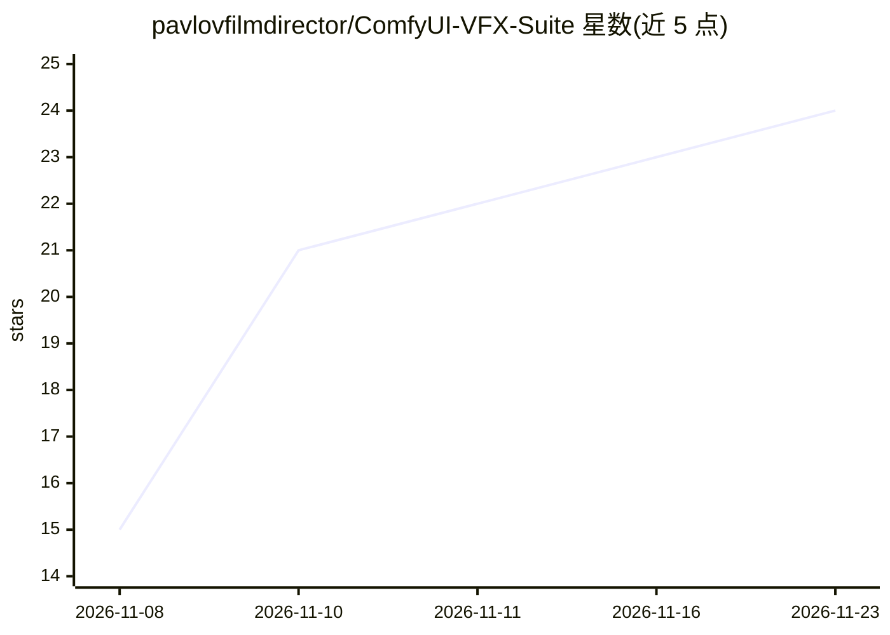

# pavlovfilmdirector/ComfyUI-VFX-Suite

⭐ 24 · JavaScript · GPL-3.0 · 推送 2026-11-06 · [GitHub](https://github.com/pavlovfilmdirector/ComfyUI-VFX-Suite) · 个人维护

**ComfyUI 内本地 VFX 工作室：素材进、成片出，全程开源权重模型**

运行在 ComfyUI 中的本地视频特效工作室（v0.1 Technology Preview）：读入实拍素材后产出掩膜、深度、姿态与摄影机轨迹（SAM 3.1、Depth Anything、DWPose、COLMAP+GLMAP），在 3D 场景中走位后用 LTX-2.5 + IC-LoRAs 生成新背景/角色、FLUX.3 Klein 设计首帧，再合成、重打光、精修、配音（Whisper→Ollama 本地翻译→F5-TTS）。不调用云 API，全部模型本地 GPU 运行，按 24 GB VRAM 调优；附本地 LLM 工作室 Agent 与 MCP 接入。权重文件不在仓库内，需另行下载。

## 筛选速览

| 维度 | 判定 | 备注 |
|---|---|---|
| AI 角色 | `ai-native` | 本体是模型或模型工具 |
| 许可风险 | `viral` | GPL-3.0 |
| 部署形态 | `library` | 以包/库形式分发 |
| 模型依赖 | local-ok | 支持本地模型 |
| 硬件要求 | — | 无带数字的原话,不猜 |
| 安装摩擦 | `medium` | 含编译或系统依赖之一 |
| 成熟度 | `idea` | |

## 能力要点

- LTX-2.5 22B + IC-LoRAs 生成视频（union-control/布局渲染/精修等），24 GB 显存下单次可到 97 帧
- SAM 3.1/SAM2 掩膜、深度、法线、DWPose、COLMAP+GLMAP 摄影机追踪
- FLUX.3 Klein 首帧生成与图像编辑、姿势迁移、非破坏图层变换
- My Pipelines 一键串联多阶段工作流；本地 LLM Agent（Ollama）执行整镜头任务并支持 MCP

## 适用场景

- 实拍素材换背景/换角色并保持人物一致性的镜头制作
- 用 3D 走位与摄影机轨迹驱动 AI 生成角色动画
- 本地完成抠像、合成、打光、配音的完整镜头交付
- 通过自然语言让 Agent 执行多步骤镜头任务

## 场景标签

`视频生成` `图像生成` `语音合成` · 领域:内容生成

## 证据(README 行号)

> L3: **A local VFX studio inside ComfyUI. Footage in, finished shot out. It runs on open-weights models only.**
> L7: You load your footage and get masks, depth, pose and the camera track. From there you block the scene in 3D, generat
> L9: No cloud APIs are used. Every model runs on your own GPU and is tuned for 24 GB of VRAM.

## 星数曲线

2026-11-08 15 → 2026-11-23 24（+9）

---
*卡片 v1 · prompt 1.4 · 生成 2026-11-18 · 置信度 mid · 依据 README sha `ef7c1488e378` · [字段定义](../../DATASET.md)*
