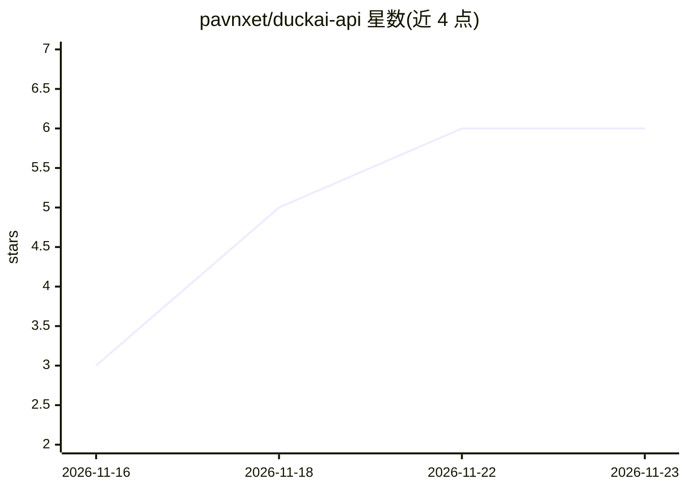

# pavnxet/duckai-api

⭐ 6 · Python · 推送 2026-11-11 · [GitHub](https://github.com/pavnxet/duckai-api) · [官网](https://pavnxet.github.io/duckai-api/) · 个人维护

**自托管的 Duck.ai 转 OpenAI 兼容 API 代理与 Web 聊天界面**

将 DuckDuckGo 的 duck.ai 聊天服务桥接为 OpenAI 兼容接口的本地代理服务，实时解决 X-Vqd-Hash-1 反爬验证并转发 SSE 流。提供 /v1/chat/completions 与 /v1/models 端点、内置暗色 Web 聊天界面、可选 API Key 鉴权、跨请求令牌隔离与自动页面回收。基于 FastAPI 与 Playwright（无头 Chromium），支持 Windows 启动脚本、Python 源码与 Docker 三种运行方式。README 声明其为独立逆向工程工具，与 DuckDuckGo 无关联。

## 筛选速览

| 维度 | 判定 | 备注 |
|---|---|---|
| AI 角色 | `ai-ecosystem` | LLM/agent 周边工具 |
| 许可风险 | `permissive` | — |
| 部署形态 | `self-host` | docker 或自建部署 |
| 模型依赖 | — | README 未给出锁定关系 |
| 硬件要求 | — | 无带数字的原话,不猜 |
| 安装摩擦 | `low` | 无编译、无系统依赖或容器化 |
| 成熟度 | — | 结构信号不足 |

## 能力要点

- OpenAI 兼容端点 /v1/chat/completions 与 /v1/models，支持流式 SSE
- 自动通过 duck.ai 的浏览器反爬验证并拦截转发 SSE
- 内置 DOMPurify 消毒的暗色 Web 聊天界面，运行在 3006 端口
- /health 端点报告浏览器桥接状态（healthy/degraded/unhealthy）

## 适用场景

- 让 Chatbox、NextChat、Cherry Studio 等桌面客户端接入 duck.ai 模型
- 在 LangChain 或 OpenAI Python SDK 中以 duck.ai 作为后端
- 本地自托管一个免 API 费用的 OpenAI 兼容聊天服务

## 场景标签

`聊天机器人` `模型网关` · 领域:Agent 开发

## 证据(README 行号)

> L5: **A high-performance, production-hardened OpenAI-compatible API proxy server and interactive Web GUI for Duck.ai (Du
> L20: **DuckAI API** bridges **DuckDuckGo's privacy-focused AI Chat (`duck.ai`)** to any OpenAI-compatible client, SDK, o
> L26: - **Standard OpenAI API Specification**: Native drop-in support for `/v1/chat/completions` (streaming & non-streami

## 星数曲线

2026-11-16 3 → 2026-11-23 6（+3）

---
*卡片 v1 · prompt 1.4 · 生成 2026-11-21 · 置信度 high · 依据 README sha `6677453f2dc9` · [字段定义](../../DATASET.md)*
