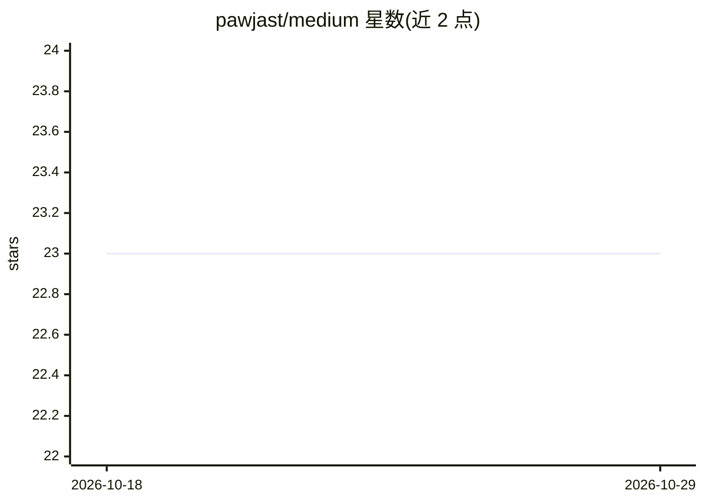

# pawjast/medium

⭐ 23 · Jupyter Notebook · MIT · 推送 2026-10-09 · [GitHub](https://github.com/pawjast/medium) · [官网](https://medium.com/@pawjast) · 个人维护

**个人 Medium 文章配套代码集合**

作者 pawjast 的 Medium 技术文章配套代码仓库，仅包含一个指向其 Medium 主页的说明 README，未在本可见范围内列出具体文章或代码目录结构。主题标签显示内容涉及数据科学、数据可视化、机器学习、Python 与统计学的教程代码。给谁用：跟随作者文章学习的读者，可结合文章复现代码示例。README 本身未提供安装、运行或依赖说明，需进入具体子目录查看。

## 筛选速览

| 维度 | 判定 | 备注 |
|---|---|---|
| AI 角色 | `ai-knowledge` | 知识聚合/清单类 |
| 许可风险 | `permissive` | MIT |
| 部署形态 | `None` |  |
| 模型依赖 | — | README 未给出锁定关系 |
| 硬件要求 | — | 无带数字的原话,不猜 |
| 安装摩擦 | `low` | 无编译、无系统依赖或容器化 |
| 成熟度 | — | 结构信号不足 |

## 能力要点

- Medium 文章配套代码仓库，与文章一一对应
- 主题标签覆盖数据科学、可视化、机器学习与统计学

## 适用场景

- 跟随作者 Medium 文章时获取并运行配套代码
- 查阅数据科学与可视化教程示例实现

## 场景标签

`教程课程` · 领域:学习与行业

## 证据(README 行号)

> L3: This is a code repository for my Medium articles.
> L5: Check me out at https://medium.com/@pawjast.

## 星数曲线

2026-10-18 23 → 2026-10-29 23（+0）

---
*卡片 v1 · prompt 1.4 · 生成 2026-10-27 · 置信度 low · 依据 README sha `3c92f337bc48` · [字段定义](../../DATASET.md)*
